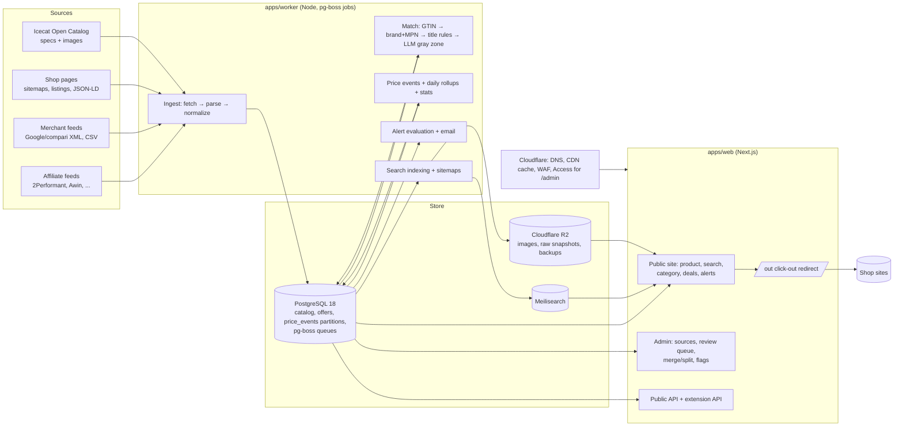

# Pretoscop — Architecture and technical decisions

Status: v1, 2026-10-27. This document is the single technical reference shared by `04-plan-normal.md` and `05-plan-modular.md`. When the plans and this document disagree, this document wins; update it (and the ADR list in §14) rather than diverging.

## 1. Constraints that shape the design

| Constraint | Consequence |
|---|---|
| Two founders, AI coding agents do most implementation | One language (TypeScript), mainstream libraries, few moving parts, everything testable from the command line |
| Infra budget ≈ €100/month at MVP | Self-hosted on one dedicated server; PostgreSQL does double duty as time-series store and job queue |
| Two access channels (`12-blocked-shops-strategy.md`): an identified crawler by default, and an assisted-access channel through a commercial data-collection service for designated blocked shops during the prototype, under the founders' legal advice | The fetch layer abstracts the channel; both share politeness, budgets, kill switches and provenance; assisted shops migrate to feeds or allowlists as those appear |
| Price history must be trustworthy from day one | Append-only observation events, never interpolated; every displayed price carries its observation time |
| Catalogue could reach millions of offers | Partitioned event table, change-only storage, daily rollups, search index separate from the database |
| SEO is the main acquisition channel | Server-rendered product pages with structured data, cacheable at the edge, fast |
| Legal exposure concentrated in eMAG and feed-ToS clauses | Every source is isolated behind a per-source kill switch; data provenance is recorded per observation |

## 2. System overview



Two deployable processes (`web`, `worker`) plus PostgreSQL and Meilisearch, all in Docker Compose on one server. The worker can be scaled to several processes by queue name (ingest, crawl, match, rollup) without code changes.

## 3. Stack

| Layer | Choice | Version policy | Why (short) |
|---|---|---|---|
| Language | TypeScript everywhere | TS 5.x, Node 24 LTS (Node 26 became Active LTS on 2026-10-28; switch once pg-boss and Next.js confirm support) | One language for agent-driven development; strong typing across packages |
| Monorepo | pnpm workspaces + Turborepo | current | Shared packages (`db`, `core`, `extractors`) used by both apps |
| Web | Next.js (App Router), React, Tailwind CSS, shadcn/ui | Next 16.4.x (16.4.3 on 2026-10-27) | SSR/ISR for millions of SEO pages; mature |
| Charts | uPlot (time series) via a thin React wrapper | current | Tiny, fast for daily series; Recharts acceptable if simpler |
| Database | PostgreSQL 18 with declarative partitioning, BRIN, `pg_trgm`, `unaccent`, `pgvector` (later) | 18.x | System of record, time series and queue in one; well understood |
| ORM / migrations | Drizzle ORM + drizzle-kit | current stable | SQL-close, type-safe, simple migrations; raw SQL allowed for partitions/rollups |
| Jobs / scheduling | pg-boss | 12.x | Cron + queues on Postgres, no Redis to operate; move to BullMQ/Valkey only if throughput demands |
| Search | Meilisearch Community (self-hosted) | 1.x | Typo tolerance, facets, fast; diacritics handled with explicit normalization (ADR-014) |
| Crawling | In-house fetcher on `undici` + `cheerio` + RFC 9309 robots parser + sitemap/feed parsers (`fast-xml-parser`, `csv-parse`) | current | Our needs are politeness, identification and extraction, not evasion; no stealth libraries (ADR-005). Crawlee 3.x `CheerioCrawler` is acceptable if its browser-fingerprint and session-rotation features stay off. Assisted-access client (`packages/fetch/assisted`) calling a vendor API (Zyte API default; Oxylabs Web Unblocker or ScrapingBee as alternates; all EU-based) behind `shops.access_mode='assisted'`, with a cost ledger and cap (ADR-015) |
| Browser rendering | Playwright, only for sources that explicitly allow us and are client-rendered | current | Rare; kept behind a flag |
| LLM | Anthropic SDK, Claude Haiku 5.5 (Batch API) for gray-zone matching and attribute extraction; Sonnet 5.5 for escalations | current | Cheapest adequate model; hard monthly budget cap (ADR-011) |
| Auth | Better Auth, magic-link email only | current | No passwords to protect; admin and merchant roles |
| Email | Resend (transactional) behind a `Mailer` interface | current | Fast to integrate; swap to SES/Scaleway for cost or EU residency later |
| Object storage | Cloudflare R2 | current | No egress fees; images, raw snapshots, backups |
| Edge / CDN / WAF | Cloudflare (free plan), Cloudflare Access for `/admin`, Cloudflare Tunnel or Caddy for ingress | current | Caching, DDoS protection, admin behind SSO |
| Hosting | Hetzner dedicated (AX41/EX44, 64 GB RAM, NVMe; €59/month + €1.70 IPv4, in stock at FSN1/HEL1 on 2026-10-27; Bucharest–Falkenstein ≈34 ms) in Germany; optional Bucharest VPS (ishosting/Hostico €6–9) or Digi Business fixed IP (€9–13) as crawler egress with a Romanian IP | current | Best €/performance after Hetzner's 2026 cloud price rises; EU data residency |
| Observability | Sentry (errors), pino JSON logs, Prometheus metrics via `prom-client` scraped by Grafana Cloud free tier, Better Stack/healthchecks.io uptime | current | Enough to see freshness, failures and latency |
| Analytics | Server-side event log (searches, click-outs, alerts; no cookies) + Plausible loaded after consent | current | ADR-010 |
| CI/CD | GitHub Actions: lint, typecheck, unit + integration tests (Postgres service), Docker build to GHCR, SSH deploy | current | Boring and reliable |
| Backups | Nightly `pg_dump` to R2 + continuous WAL archiving (pgBackRest or WAL-G) with weekly scripted restore test | current | PITR; history is the asset |

Versions pinned on 2026-10-27 (re-check patch versions at implementation time): Next.js 16.4.3; Drizzle 0.45.4 (1.0 still a release candidate); Prisma 7.10.1 if chosen (pin it: the CLI's npm `latest` tag points to an 8.0 RC); Better Auth 1.7.14; pg-boss 12.38.0 (needs Node ≥ 22.12; cron/RRULE, singleton keys, dead-letter queues, OpenTelemetry); Crawlee 3.18.2 (`sameDomainDelaySecs`, `respectRobotsTxtFile: { userAgent }`; keep `retryOnBlocked` off, it exists to bypass bot protection); Meilisearch 1.56.0 (licence "MIT AND BUSL-1.1": confirm the Community features we use are MIT-licensed); Typesense GPL-3.0; pgvector 0.8.7; Playwright 1.64.1; WXT for the extension build (Plasmo is stale since May 2025).

## 4. Repository layout

```
pretoscop/
  apps/
    web/                 Next.js: public site, admin, API routes, click-out
    worker/              pg-boss workers: ingest, crawl, match, rollup, alerts, index, maintenance
    extension/           (phase 4) browser extension, MV3
  packages/
    db/                  Drizzle schema, migrations, partition + rollup SQL, seed, typed queries
    core/                Pure domain logic: money/VAT, GTIN, text normalization (RO), attribute
                         extraction, matching rules + scoring, pricing (total price), discount
                         verdicts, anomaly filters. No I/O. 100% unit-tested.
    extractors/          Per-source parsers: feed mappers (2Performant, Google Shopping XML,
                         compari XML, CSV), page extractors (JSON-LD, microdata, OpenGraph,
                         per-shop CSS fallbacks), sitemap/listing parsers. Fixture-tested.
    fetch/               Polite HTTP client: identified UA, per-domain throttle, robots.txt
                         cache, retry/backoff, block detection, request logging
    llm/                 Anthropic client wrapper: prompts, batch jobs, caching, budget caps
    search/              Meilisearch index definitions, document builders, sync
    config/              Shop registry (YAML → validated types), feature flags, env schema
    ui/                  (optional) shared React components
  docs/                  This documentation, plans, progress tracker, ADRs
  infra/                 docker-compose.*.yml, Caddyfile/cloudflared, backup scripts, runbooks
  scripts/               One-off CLIs: import taxonomy, verify module, restore test, seeds
  Makefile               make dev / test / verify M=xx / deploy
```

Rules: `core` and `extractors` must have no database or network imports; `worker` and `web` compose them. Every package has its own `README.md` stating its contract.

## 5. Data model

Money is `numeric(12,2)` in RON including VAT. Times are `timestamptz`. IDs are `bigint` identity except where noted. Only the key columns are listed; the Drizzle schema in `packages/db` is authoritative.

### 5.1 Sources and shops

| Table | Key columns | Notes |
|---|---|---|
| `shops` | `id, slug, name, domain, website_url, logo_key, kind ('retail','marketplace_host'), status ('active','paused','blocked','removed'), access_mode ('direct','assisted','feed_only','off'), legal_basis_ref, trust_tier (1–3), shipping_rules jsonb, warranty_months_default, crawl_policy jsonb, legal_notes, created_at` | `shipping_rules`: `{free_over, flat, locker_flat, notes}`; `crawl_policy`: `{min_interval_ms, max_concurrency, allowed_hours, max_pages_per_day}` |
| `affiliate_programs` | `id, shop_id, network, program_external_id, commission_text, cookie_days, comparator_policy ('allowed','forbidden','unknown','written_ok'), link_template, feed_available, status` | `comparator_policy` gates whether affiliate links are used |
| `shop_sources` | `id, shop_id, kind ('feed','sitemap','listing','product_page','manual'), url, format, parser_key, schedule, config jsonb, enabled, kill_switch, last_run_at, last_success_at, health ('ok','degraded','failing','blocked')` | One shop may have several sources (feed for catalogue + listing crawl for freshness) |
| `ingest_runs` | `id, source_id, started_at, finished_at, status, stats jsonb, error_sample text, snapshot_key, channel ('direct','assisted','feed')` | `snapshot_key` points at the raw payload stored in R2 |
| `access_costs` | `day, shop_id, vendor, requests, rendered_requests, cost_cents` | Assisted-access ledger; the monthly cap is enforced in `packages/fetch` |

### 5.2 Catalogue

| Table | Key columns | Notes |
|---|---|---|
| `brands` | `id, name, slug, aliases text[]` | Alias table drives brand detection |
| `categories` | `id, parent_id, slug, name_ro, name_en, google_taxonomy_id, depth, path` | Google Product Taxonomy subset, Romanian names curated |
| `product_families` | `id, slug, title, brand_id, category_id, attributes jsonb` | Model-level grouping (e.g. "iPhone 17 Pro"); optional |
| `products` | `id, slug, title, brand_id, category_id, family_id, mpn, attributes jsonb, primary_image_id, status ('active','merged','hidden'), merged_into_id, offer_count, min_price, min_total_price, min_shop_id, created_at, updated_at, created_by ('feed','crawl','icecat','manual')` | Canonical product = the sellable variant (what a GTIN identifies). ADR-012 |
| `product_gtins` | `gtin14 (PK), product_id, source, confidence, created_at` | Validated, 14-digit zero-padded |
| `product_images` | `id, product_id, storage_key, source ('feed','icecat','manual'), source_url, license_note, width, height, is_primary` | Only licensed sources. ADR-008 |
| `product_specs` | `product_id, source, data jsonb, locale, fetched_at, attribution` | Icecat requires attribution and no AI-training use |

### 5.3 Offers and prices

| Table | Key columns | Notes |
|---|---|---|
| `offers` | `id, shop_id, source_id, source_tier (1 crawl or merchant feed, 2 affiliate feed, 3 user report, 4 link-only), external_id, product_id (nullable), url, affiliate_url, title_raw, brand_raw, mpn_raw, gtin_raw, category_raw, price, old_price, shop_lowest_30d, currency, shipping_cost, shipping_note, availability ('in_stock','out_of_stock','preorder','unknown'), condition ('new','refurbished','used'), seller_name, seller_type ('shop','marketplace'), is_bundle, match_status ('auto','manual','pending','unmatched','rejected'), match_score, match_reason, first_seen_at, last_seen_at, last_checked_at, price_changed_at, content_hash, active` | `UNIQUE (shop_id, external_id)`; `last_checked_at` advances on every confirmation even when nothing changed |
| `price_events` | `id, offer_id, observed_at, price, old_price, shipping_cost, availability, run_id` | **Partitioned by month on `observed_at`**; row written only when price/old_price/shipping/availability changed or on first sight; BRIN on `observed_at`, btree `(offer_id, observed_at)` |
| `product_daily` | `product_id, day, min_price, min_total_price, min_offer_id, min_shop_id, median_price, offer_count, in_stock_count` | Rollup job; drives charts and SEO "price from" |
| `product_stats` | `product_id, min_30d, min_30d_at, min_all_time, min_all_time_at, median_90d, last_change_at, drop_pct_7d, verdict, observations_days, updated_at` | Recomputed after rollups; `verdict` ∈ {`good_price`,`usual`,`above_usual`,`insufficient_data`} |

Raw observations (every parsed offer of every run, before change detection) are written as gzipped JSONL to R2 (`snapshots/{source}/{run}.jsonl.gz`). They are the audit trail and allow recomputation if a rule changes. Expected volumes: measured online price-change rates are 1.3–2.6% of items per day (Cavallo); the research planning table gives roughly 15–75M event rows per year at 2M offers (17.5M at 2.4%/day, 73M at 10%/day including stock changes) against 730M for daily snapshots. Measure Pretoscop's own change rate in month 1.

### 5.4 Matching

| Table | Key columns | Notes |
|---|---|---|
| `match_candidates` | `id, offer_id, product_id, score, features jsonb, generator ('gtin','brand_mpn','title','embedding'), created_at` | |
| `match_decisions` | `id, offer_id, product_id (nullable), decision ('accept','reject','new_product','needs_review'), decided_by ('rule','llm','human:<user_id>'), reason, created_at` | Append-only audit |
| `offer_aliases` | `shop_id, external_id, product_id, decided_by, created_at` | Sticky human decisions survive re-ingestion |
| `product_merges` | `id, from_product_id, into_product_id, actor, created_at` | Enables undo; old slug 301-redirects |

### 5.5 Users, alerts, clicks, merchants

| Table | Key columns | Notes |
|---|---|---|
| `users` (+ Better Auth tables) | `id, email, role ('user','admin','merchant'), created_at` | |
| `alerts` | `id, user_id, product_id, kind ('below','any_drop'), target_price, channel ('email','push','telegram'), status, consent_at, consent_ip_hash, consent_text_version, last_notified_at` | Double opt-in evidence stored (Law 506/2004) |
| `alert_sends` | `id, alert_id, sent_at, price, offer_id, provider_message_id` | |
| `clicks` | `id, offer_id, product_id, shop_id, ts, is_affiliate, placement, referer_type, ua_hash, ip_hash, session_hash` | Hashed with a daily rotating salt; no raw IP |
| `merchants` | `id, user_id, shop_id, company_name, cui, contact_email, feed_url, status, plan` | Self-serve portal (phase 3) |
| `feature_flags` | `key, enabled, config jsonb` | e.g. `source.emag.enabled`, `llm.matching.enabled` |
| `audit_log` | `id, actor, action, entity, entity_id, before jsonb, after jsonb, ts` | Admin actions |

## 6. Pipelines

### 6.1 Ingestion (feeds and crawls share one path)

```
fetch (packages/fetch) → raw payload → R2 snapshot
  → parse (packages/extractors) → RawOffer[]
  → normalize (packages/core): price parsing (RON, "1.234,56 lei"), VAT flag, GTIN validation,
    brand detection, MPN normalization, title cleanup, attribute extraction, condition/bundle flags,
    availability mapping, shipping from shop rules
  → upsert offers (UNIQUE shop_id+external_id) with content_hash comparison
  → price_events insert when hash of (price, old_price, shipping, availability) changed
  → enqueue match for new/changed-title offers
  → ingest_runs stats; health update; alerts on failure
```

The upsert uses PostgreSQL 18's `INSERT … ON CONFLICT DO UPDATE … RETURNING old.price, new.price` to decide in one statement whether a price event is due. Idempotency: a run that is retried re-reads its R2 snapshot and never double-inserts events (event uniqueness on `(offer_id, observed_at)` truncated to the run). Downloads use conditional GET (ETag/If-Modified-Since) and a payload whose sha256 was already processed is skipped. Deactivation: an offer missing from two consecutive successful, full-size runs becomes inactive; if a feed's row count drops more than 30% against its 7-day median, the run is held for review instead of deactivating offers. Replay mode re-runs normalize → match → events from stored snapshots with the original `observed_at` and suppresses alerts.

### 6.2 Crawling (shops without feeds)

- **Identification**: `User-Agent: Mozilla/5.0 (compatible; PretoscopBot/1.0; +https://pretoscop.ro/bot)`, fixed egress IPs with reverse DNS, bot page listing IPs, contact and opt-out. Apply for Cloudflare Verified Bots (Web Bot Auth or IP validation; small comparators such as idealo, Skroutz and the Romanian PretAlertBot are already verified), Akamai Bot Directory and DataDome's good-bot list (its "Comparators" category needs each shop's opt-in); the IAB/ABC list is not worth its $5k–15k/year.
- **robots.txt**: RFC 9309 parser, cached ≤24h, 5xx treated as disallow-all, `Crawl-delay` honoured if present even though non-standard.
- **Politeness**: per-domain minimum interval (default 5 s, configurable per shop), concurrency 1 per domain, daily page budget per shop, off-peak preference (02:00–07:00 Romania time for bulk), exponential backoff on 429/503/5xx, automatic pause of the source for 24h on 403/challenge, never more than 3 consecutive failures before pausing.
- **Discovery**: sitemaps where they exist, category listing pages (60–70 offers per request on eMAG/Dedeman), feeds for catalogue. eMAG specifics: about 4.2M product URLs in 841 `offers-available` files of 5,000 URLs each, served `no-store` with a constant `lastmod`, so a daily sweep (841 requests, about 70 minutes at one request per 5 s) is used only to diff the URL set for discovery and delisting, together with the `offers-latest` index (about 9 files, ≈45k offers); the `offers-unavailable` index shrank from 3,991 files in January 2026 to 27, so it is not a reliable delisting signal (use absence from listings plus product-page 404/410). Other sellers' offers are present in product HTML as a `secondary_offers` array. A product-page pass over the whole catalogue is impossible politely (about 146 days at one request per 3 s), so daily coverage is selective (launch categories, hot products, promotions) via listing pages. eMAG varies responses by User-Agent (`vary: User-Agent`), so robots.txt is re-read with the exact production UA before launch.
- **Block detection**: transport errors (HTTP/2 stream resets, TLS failures, connect timeouts) and HTTP-200 interstitials (`<title>Client Challenge</title>`, `/_fs-ch-`, `EO_Bot_Ssid`, "Distinct Captcha") count as blocks; cross-domain redirects to CAPTCHA hosts are never followed; vendor names inside robots.txt bodies are not treated as challenges.
- **Refresh tiers**: Tier A (top products by views/alerts) daily product-page verification; Tier B (everything with ≥2 offers) daily via listings; Tier C (long tail) weekly. Freshness SLO per shop stored in `crawl_policy`.
- **Extraction order**: JSON-LD `Product`/`Offer` → microdata → OpenGraph → per-shop CSS selectors (recorded fixtures per shop; a CI test fails when a fixture stops parsing).
- **Blocked shops**: by default not crawled; they enter via feeds, merchant onboarding or allowlisting, or, for the designated prototype set, the assisted-access channel. The admin shows each shop's access mode, success rate and monthly cost.
- **Assisted access** (designated shops only, `shops.access_mode='assisted'`, ADR-015): the same `fetchPolite` call routes the request through the vendor API (HTTP tier by default; browser-rendered tier only where the price is client-rendered, per shop config), keeps our per-domain interval and daily budget, records `access_costs`, and still obeys robots.txt (fetched through the same channel when the direct fetch is blocked). Public product, category and sitemap pages only. Each such shop carries `legal_basis_ref` and its own kill switch; success below 80% for 7 days auto-pauses the shop. Exit per shop: feed or allowlist (M21).
- **Never (either channel)**: self-operated challenge or CAPTCHA solvers, self-hosted stealth browsers, self-managed residential proxies, undocumented internal APIs (for example eMAG's `sapi.emag.ro` or Altex's `fenrir.altex.ro`), login/cart/checkout pages, hotlinking or copying shop images, personal data.

### 6.3 Matching

```
candidates:
  1. GTIN: gtin_raw valid (GTIN-8/12/13/14 check digit, not restricted 02/04/2x, not coupon 05/98/99,
     not placeholder) → product_gtins lookup. Never auto-merge on GTIN alone when is_bundle or
     condition != 'new' or the title's hard attributes contradict the product.
  2. brand + normalized MPN exact.
  3. title: brand + model tokens + attribute set → Meilisearch/pg_trgm search in the same category;
     top 10 by similarity.
  reality check (Web Data Commons 2024): only about 8% of schema.org Product entities carry a GTIN, on .ro
     sites too, while 26% of Romanian ones carry an MPN; Altex listings embed EANs, Notino/Bonami/iStyle mark
     up GTINs, Flanco/evoMAG/Vexio only MPNs. GTIN is the key where it exists; brand+MPN carries the rest.
  4. (phase 4) embeddings (pgvector) for long-tail recall.
scoring (packages/core/matching):
  hard constraints: condition == new; !is_bundle; storage/RAM/size/color must not conflict;
  category compatible.
  score ∈ [0,1] from token overlap, attribute agreement, brand, MPN, source trust.
routing on a calibrated probability p: p ≥ 0.97 with no hard conflict → accept (decided_by 'rule');
  p ≤ 0.30 → reject; between → LLM pairwise verification (Haiku 5.5 Batch, JSON {label, confidence,
  conflicting_attributes}); LLM confidence ≥ 0.9 accept, else human queue; no acceptable candidate and a
  valid GTIN+brand → create a provisional product (noindex until it has ≥2 offers, Icecat specs or human
  verification); else 'unmatched' queue. Design target: ≥99.5% precision on auto-decisions, re-measured
  weekly on 200 random auto-matches.
sticky: offer_aliases override everything; merges rewrite product ids and keep history; re-matching runs
  only when identity_hash(title_norm, gtin14, mpn_norm, brand_id) changes, and human decisions lock the
  mapping until then. Review-queue priority = expected traffic × uncertainty.
metrics: per-source match rate, auto/LLM/human share, sampled precision (weekly 100-offer audit).
```

Variants: colour, storage and size that change the GTIN are separate products; a `product_family` groups them for the family page and for alerts "any variant".

### 6.4 Price history, rollups and verdicts

- `product_daily` computed nightly (and incrementally after each ingest for touched products): min and median across in-stock, new-condition, non-bundle offers from shops with `trust_tier ≤ 2` and `source_tier ≤ 2`; user-reported observations (tier 3) are shown with their label and date but never rank or enter the minimum series; marketplace sellers included but flagged, and excluded from the "shop minimum" series shown by default.
- `product_stats`: 30-day minimum (our observations), all-time minimum, 90-day median, drop over 7 days, `observations_days`.
- Discount display rule: show "−X% față de minimul ultimelor 30 de zile" only when `observations_days ≥ 14`; otherwise show "istoric de N zile". The shop's crossed price is labelled "preț de referință afișat de magazin".
- Discount-verification facts per offer, computed only when our history covers the window (never in an offer's first 30 days): (1) *reference not supported*: the shop's crossed price is more than 2% above the lowest price we observed at that shop in the 30 days before the reduction started; (2) *raise-then-cut*: the maximum price over [t−30d, t−3d] is at least 15% above the median over [t−60d, t−31d] and the current price is at least 97% of that earlier median; (3) *phantom old price*: the crossed price was never an observed selling price in the last 90 days; (4) *market-irrelevant discount*: the claimed reduction exceeds 30% but the price is at or above the cross-shop median. Wording is factual and reproducible (`07-legal-compliance-checklist.md` §2), evidence (snapshots, timestamps) is kept, and merchants get a correction channel.
- Anomaly filter (`packages/core/anomaly`): reject outright prices ≤ 1 RON, zero or placeholder prices (e.g. 9,999,999) and out-of-range magnitudes; quarantine when the ratio to the offer's 14-day median is above 3 or below 0.33, re-check within 1–2 hours and publish only after two consecutive agreeing observations (ratios near 10, 100 or 1,000 usually mean a decimal or thousands-separator bug); an offer below 0.3× the product's cross-shop median goes back to the matcher before it can be "cel mai mic preț"; run-level breaker: if more than 20% of a shop's offers move more than 50% in one run, hold the run and alert. Currency: store the observed currency and convert EUR with the BNR daily reference rate from `https://curs.bnr.ro/nbrfxrates.xml` recorded on the event (EUR 5.3487 RON on 2026-10-27); detect "fără TVA" prices and gross up or exclude them. Warranty months are shown but never rank.
- Chart API: `/api/products/{id}/history?range=30d|90d|1y|all&series=min|shops` returns daily points; steps extend to `last_checked_at`.

### 6.5 Alerts

Daily (and after each rollup for touched products): for each active alert, compare `product_stats.min_total_price` (or the chosen variant) with the target; send at most one email per alert per 24h; include the triggering offer, the shop, the observation time, sender identity and a one-click unsubscribe (List-Unsubscribe header). Consent is explicit (double opt-in) and logged with text version.

### 6.6 Search and sitemaps

Meilisearch index `products`: `id, title, title_ascii, brand, category_path, attributes, min_price, min_total_price, offer_count, has_history, popularity, image`. Searchable attributes: `title, title_ascii, brand, model_compact, family, category_names, aliases`; typo tolerance disabled on `model_compact` and GTINs (a 13–14-digit query takes a direct filter path). Ranking: words, typo, proximity, attribute, sort, exactness, then `popularity:desc` (decayed sum of click-outs, views, alert subscriptions and offer count, recomputed nightly), `offer_count:desc`. Autocomplete uses multi-search over products, categories and brands with prefix search on the last word. Synonyms for Romanian plurals and common variants (`televizor/televizoare`, `laptop/laptopuri`, `frigider/frigidere`, `telefon/telefoane`). Re-index on product change via job; full rebuild script.

Index policy: a product page is indexable when it has ≥2 live offers or ≥14 days of history; provisional products (<2 offers, unverified) and search/facet pages are `noindex,follow`; curated brand×category landing pages are indexable. Sitemaps: `sitemap.xml` index → `sitemap-products-{n}.xml` (≤ 50k URLs each, `lastmod` = last price change), categories, brands, shops; only indexable products are listed.

## 7. Web application

### 7.1 Routes

| Route | Rendering | Cache |
|---|---|---|
| `/` | ISR 10 min | edge 5 min |
| `/cauta?q=` | SSR (Meilisearch) | no |
| `/p/{slug}-{id}` | SSR with Next data cache tagged `product:{id}`; invalidated on price change | edge 2 h (the Cloudflare Free plan's minimum TTL override) with an API purge on material price change; anonymous responses must carry no `Set-Cookie`, or Cloudflare never caches them |
| `/c/{...path}` | ISR 1h | edge 15 min |
| `/b/{slug}` , `/magazin/{slug}` | ISR 1h | edge 15 min |
| `/reduceri` | ISR 15 min | edge 5 min |
| `/alerte`, `/auth/*` | dynamic, authenticated | no |
| `/out/{offerId}` | dynamic 302 redirect, logs click, `X-Robots-Tag: noindex`; links to it carry `rel="sponsored nofollow"` when affiliate | no |
| `/pentru-magazine`, `/bot`, `/despre`, `/cum-functioneaza`, `/cum-castigam-bani`, `/termeni`, `/confidentialitate`, `/cookies`, `/contact` | static | long |
| `/api/v1/*` | public read API (key-gated, rate-limited) | short |
| `/api/ext/*` | extension endpoints | short |
| `/admin/*` | dynamic, Better Auth role `admin`, Cloudflare Access in front | no |

### 7.2 Product page content order

1. Title, brand, category breadcrumbs, image (licensed), key specs.
2. Best total price now, shop, "verificat acum N ore", and the verdict line.
3. Offers table: shop logo, price, delivery, total, stock, seller type, last check, button "Vezi oferta". Default sort total ascending; filters: in stock only, exclude marketplace sellers, condition.
4. Price history chart with range selector; stats row (30-day low, all-time low, median 90d); "Istoricul începe la {date}".
5. Alert form (email; explicit consent checkbox with versioned text).
6. Disclosure footer: how ranking works (link), affiliate relationship note when applicable, data freshness statement.

### 7.3 Structured data and SEO

`Product` with `brand`, `gtin13`/`mpn` when known, `image`, `offers` as `AggregateOffer` (`lowPrice`, `highPrice`, `offerCount`, `priceCurrency: RON`) plus up to 10 `Offer` items with `seller`; `BreadcrumbList`; `WebSite` with `SearchAction` on the home page; `ItemList` on category pages (required for aggregator carousels in the EEA, together with Google CSS enrolment later). Each variant page carries its own `AggregateOffer`; family pages list variants as an `ItemList` without a cross-variant `AggregateOffer`. Canonical URLs, Romanian `hreflang="ro"`, Open Graph, descriptive titles ("{product} – prețuri de la {min} lei la {n} magazine"). Core Web Vitals budget: LCP < 2.5 s on mobile, JS < 150 kB on product pages.

### 7.4 Admin

Dashboard (sources: last run, items, changes, errors, freshness vs SLO; queues depth; LLM spend month-to-date), review queue (side-by-side offer vs candidate products, accept/reject/new/merge), product editor (title, brand, category, images, GTINs, family), offer tools (unlink, blacklist, mark bundle), shop and source editor (policy, kill switch), flags, audit log, "run now" buttons.

## 8. External integrations

| Service | Use | Notes |
|---|---|---|
| 2Performant API (`api.2performant.com`) | List approved programs and each program's "Price Comparison Services" permission (yes/maybe/no; 180 days' notice before an allowed type is withdrawn), commissions; feeds downloaded from dashboard-generated URLs (Tools → My feeds) | 100 req/min; write clearance for ToS §9 (database/information service) before relying on feeds for history |
| Awin / CJ / Tradedoubler | Feeds and links for Douglas, Samsung, Xiaomi, About You, Answear, Notino, Modivo (where approved) | Each network has its own feed format; mappers in `extractors` |
| Open Icecat | Specs and images for IT/electronics; free tier covers Samsung, LG, Lenovo, Dell, Philips, Kingston (Sony, Xiaomi, Logitech, AMD need the paid tier; Apple is restricted); Romanian spec labels are localised but marketing text is rare (1 of 8 sampled) | Attribution "Specs Icecat", 1M downloads/month/locale, share-alike; keep Icecat data in `product_specs`/`product_images` only, never in B2B products; block AI crawlers in robots.txt as required |
| Anthropic API | Gray-zone matching, attribute extraction, Romanian category naming help | Batch API, prompt caching, monthly cap in `packages/llm` |
| Resend | Magic links, alert emails, merchant notifications | DKIM/SPF/DMARC on `pretoscop.ro`; List-Unsubscribe |
| Cloudflare | DNS, cache, WAF, Access, R2, Tunnel | Free plan sufficient at MVP |
| Sentry, Grafana Cloud, Better Stack | Errors, metrics, uptime | Free tiers |
| Google Search Console, Bing Webmaster | Index monitoring, sitemaps | Required at launch |

## 9. Observability and SLOs

| Signal | SLO | Alert |
|---|---|---|
| Feed source freshness | last success < 24h | 2 consecutive failures → Telegram/email |
| Offer freshness | ≥95% of active offers observed within 26h; top 10% most-viewed products within 6h | daily report |
| Parse-reject rate per source | < 2% of rows | alert |
| Extractor canary (weekly: 5 live URLs per shop, field presence and type) | no drift | alert |
| Assisted channel | success ≥90% per shop; spend < monthly cap | daily; auto-pause below 80% for 7 days |
| Match queue | human queue < 500 items | weekly |
| Web p95 TTFB (product page, cached) | < 400 ms | Better Stack |
| Error rate | < 0.5% of requests | Sentry alert |
| Backup | nightly success + weekly restore test | failure → alert |
| LLM spend | < monthly cap | 80% warning, 100% hard stop |

## 10. Security and privacy

- Secrets only in server `.env` (or sops-encrypted in `infra/`), never in git. Separate API keys per environment; the assisted-access vendor key has a spend limit at the vendor and an 80% alert in our ledger.
- `/admin` behind Cloudflare Access + Better Auth admin role; audit log for every mutation.
- Public API rate limiting (per key, per IP), CSP, HSTS, no inline scripts except JSON-LD.
- Personal data minimization: emails for alerts/merchants only; click logs hashed; no raw IPs stored; retention policy (clicks 13 months aggregated after 90 days).
- Data subject requests: admin tool to export/delete a user.
- Dependency audit in CI; Dependabot; container images pinned by digest.

## 11. Environments and deployment

- `dev`: Docker Compose (Postgres, Meilisearch, Mailpit for email), `make dev` seeds a fixture catalogue.
- `staging`: same compose file on the production server under a different project name and subdomain (`staging.pretoscop.ro`, `noindex`, Cloudflare Access).
- `prod`: Compose with `web` (2 replicas), `worker` (queues split: `ingest`, `crawl`, `match`, `rollup`), Postgres (tuned: shared_buffers 16 GB, WAL archiving), Meilisearch, Caddy or cloudflared, backup sidecar.
- Deploy: GitHub Actions on tag → build images → push GHCR → SSH `docker compose pull && docker compose up -d`; migrations run by a one-shot `migrate` service before `web` starts; rollback = previous tag.
- Crawler egress: the production host's dedicated IPv4 with reverse DNS `bot.pretoscop.ro`; optional Bucharest VPS (`crawler-ro`) running only the `crawl` worker against the same database over WireGuard.

## 12. Cost estimate (monthly, 2026 list prices)

| Item | MVP (≈50k products / 200k offers) | 500k offers | 2M offers |
|---|---|---|---|
| Hetzner dedicated server | €61 (AX41/EX44 €59 + €1.70 IPv4) | €80–160 (one larger box or two) | €250–500 |
| Cloudflare (free) + R2 | €0–3 | €5–15 | €20–40 |
| Resend | €0–20 | €20–90 | €90–250 |
| LLM matching (Haiku 5.5 Batch) | €4–12 | €36–120 | €140–480 |
| Sentry/Grafana/uptime | €0 | €0–30 | €30–80 |
| Optional Bucharest VPS or Digi fixed IP | €6–13 | €6–20 | €20–40 |
| Assisted-access vendor (designated shops, listing-based refresh; ADR-015) | €50–150 | €300–600 | €1,500–2,500 |
| **Total** | **≈€120–270** | **≈€450–1,030** | **≈€2,050–3,900** |

Hetzner prices exclude VAT and the IPv4 add-on. If the LTD dedicated lines are sold out, the cloud fallback (CPX32 + CPX22 ≈ €55) gives far less RAM and CPU for the same money.

## 13. Romanian text and money rules (packages/core)

- Canonical diacritics: U+0219 ș, U+021B ț (comma below); convert legacy cedilla forms (U+015F ş, U+0163 ţ) at ingest. Store `title` canonical and `title_ascii` folded for search and slugs.
- Price parsing accepts `1.234,56 lei`, `1234.56 RON`, `1 234,56 Lei`, `de la 1.234 lei`; reject ranges and "lei/lună" instalment strings as the main price.
- VAT: prices are stored VAT-included (21% standard since 1 Aug 2025); feeds flagged `vat_included=false` are grossed up at ingest with the rate valid at the observation date.
- Formatting: `1.234,56 lei`, dates `27 oct. 2026, 14:05`.

## 14. Architecture decision records (summaries)

| ADR | Decision | Rejected alternatives | Reason |
|---|---|---|---|
| ADR-001 | TypeScript monorepo for web and workers | Python backend + TS frontend | One language, one build, shared types; scraping needs are modest |
| ADR-002 | PostgreSQL 18 as system of record, time series (monthly partitions, change-only events) and queue | TimescaleDB, ClickHouse | Volumes fit Postgres for years; fewer systems to operate; Timescale optional later |
| ADR-003 | pg-boss for jobs | BullMQ (+Valkey), Temporal, Airflow | No extra infra; cron + retries + priorities suffice |
| ADR-004 | Meilisearch Community | Typesense, OpenSearch, Postgres FTS | Best typo tolerance/facets per ops effort; Romanian handled via normalization |
| ADR-005 | In-house polite fetcher; no self-built stealth tooling | Crawlee defaults, Scrapy, Camoufox | Identification, throttling and extraction are our needs; self-operated evasion tooling is a maintenance sink and a liability |
| ADR-006 | Change-only `price_events` + `product_daily` rollups + raw JSONL snapshots in R2 | Daily full snapshots in DB | 10–40× fewer rows; audit trail preserved |
| ADR-007 | Self-hosted Hetzner + Cloudflare | Vercel, Fly.io, managed Postgres | Cost at scale; control over crawler IPs; EU residency |
| ADR-008 | Images only from feeds (licensed for promotion) and Open Icecat; placeholders otherwise | Hotlinking/copying shop images | Copyright risk; eMAG terms forbid reuse of content |
| ADR-009 | Magic-link auth (Better Auth) | Passwords, social login | Less to secure; enough for alerts and merchants |
| ADR-010 | Server-side event log + Plausible after consent | GA4 | ePrivacy/GDPR simplicity; product metrics don't need cookies |
| ADR-011 | Claude Haiku 5.5 Batch for gray-zone matching with hard caps | Fine-tuned matcher, Sonnet by default | ≈$0.02–0.13 per 1,000 pairs; escalate selectively |
| ADR-012 | Canonical product = GTIN-level variant; families group variants | Model-level products only | Prices differ by variant; GTIN is the global key |
| ADR-013 | eMAG is an isolated source behind a kill switch; crawled only under the founders' documented decision (plan §3); no affiliate relationship with eMAG/Profitshare | Excluding eMAG; using eMAG internal APIs | Product viability vs. explicit ToS prohibition; keep exposure removable in minutes |
| ADR-014 | Romanian normalization: comma-below canonical; ASCII-folded search fields; synonym lists | Relying on search engine language packs | Cedilla/comma mix in real data; Meilisearch has no Romanian stemmer |
| ADR-015 | Assisted-access channel through a commercial data-collection service (Zyte API default) for the designated blocked shops during the prototype, under the founders' legal advice (2026-10-27), with identical politeness, a cost cap, kill switches and an exit per shop to feeds or allowlists | Self-hosted stealth browsers and residential proxies; excluding the blocked majors | Coverage of the electronics majors in the prototype without operating evasion tooling ourselves |
