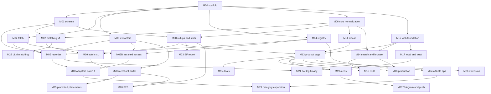

# Pretoscop — Implementation plan (modular, supervision-friendly)

Status: v1, 2026-10-27. This plan contains exactly the work of `04-plan-normal.md`, cut into 30 modules (M00–M29) with explicit contracts, acceptance tests and a five-minute founder verification each, grouped in five phases with approval gates. Technical reference: `03-architecture.md`. Progress is tracked in `progress.md`.

---

## Part A — How the build is supervised

### A.1 The loop for every module

1. **Start**: the implementing agent sets the module to `in_progress` in `docs/progress.md`, creates branch `mod/MXX-short-name`, and reads the module's contract below plus the relevant sections of `03-architecture.md`.
2. **Build**: small commits prefixed `MXX:`. Stay inside the declared scope; if an interface of another module must change, say so in the report. If the module is taking more than twice its effort estimate, stop and report.
3. **Verify**: `make verify M=XX` must pass (unit/integration tests tagged for the module + smoke checks + a printed human checklist). The agent runs it and pastes the summary in the report.
4. **Report**: open the PR with the module report (template in `progress.md`), set status `review`.
5. **Founder check (≤5 minutes)**: run the "Founder verification" steps of the module. Approve and merge, or request changes.
6. **Gate**: at the end of each phase, the founders check the gate criteria and record the approval date in `progress.md`. The next phase does not start before that.

### A.2 Parallel work

Modules without a dependency between them can be implemented by separate agent instances in separate git worktrees. Safe parallel sets:

- After M00 and M01: {M02, M03, M04, M06}
- After M02–M04: {M05, M05B}
- After M05: {M07, M08, M11, M12}
- After M08: {M09, M13, M14, M17, M10}
- Phase 3: {M19, M20, M21, M22, M23}
- Phase 4: {M24, M26, M27} then {M25, M28, M29}

### A.3 Dependency graph



### A.4 Module contract template

Every module below has: **Goal**, **Depends on**, **Scope in / out**, **Deliverables**, **Interface contract** (what other modules may rely on), **Tasks**, **Acceptance tests** (automated), **Founder verification** (manual, ≤5 minutes), **Human tasks needed** (from `09-external-setup-checklist.md`), **Effort** (S ≈ 0.5–1 agent-day, M ≈ 1–2, L ≈ 2–4), **Notes/risks**.

### A.5 Conventions that make verification cheap

- `make verify M=XX` is implemented by `scripts/verify/MXX.sh` (created in the module itself). It runs `pnpm test --filter` for the module's packages, any smoke script, and finally prints the founder checklist.
- Every module adds or updates its package `README.md` with the contract.
- Fixtures are real recorded pages/feeds with the recording date in the file name (`emag_product_2026-10-29.html`). Never edit a fixture by hand; re-record.
- Feature flags default **off** for anything that touches shops, money or email.

---

## Part B — Phase 0: Record prices now (gate G0, target before 6 Nov 2026)

### M00 — Repo scaffold and dev environment
**Goal**: a monorepo in which every later module has a place, with CI, local stack and the `make` entry points.
**Depends on**: nothing.
**Scope in**: pnpm workspaces + Turborepo; `apps/web` (Next.js app shell, one page), `apps/worker` (pg-boss bootstrap with a heartbeat job); packages `db`, `core`, `extractors`, `fetch`, `config`, `llm` (stubs with README contracts); TypeScript strict config; ESLint, Prettier; Vitest; `docker-compose.dev.yml` (Postgres 18, Meilisearch, Mailpit); `.env.example` with every variable documented; `Makefile` (`dev`, `test`, `lint`, `migrate`, `seed`, `verify M=`, `shops:sync`); GitHub Actions CI (lint, typecheck, test, build); `scripts/verify/` runner; `docs/progress.md` wiring.
**Scope out**: any domain logic; production compose.
**Deliverables**: the repository tree of `03-architecture.md` §4; `README.md` with setup steps.
**Interface contract**: package names `@pretoscop/db`, `@pretoscop/core`, `@pretoscop/extractors`, `@pretoscop/fetch`, `@pretoscop/config`, `@pretoscop/llm`; env loading via `@pretoscop/config/env` (zod-validated); `make verify M=XX` convention.
**Tasks**: scaffold; CI; compose; Makefile; verify runner; README.
**Acceptance tests**: CI green on the PR; `make dev` starts the stack and the worker logs a heartbeat; `make verify M=00` prints "OK".
**Founder verification**: clone fresh, `cp .env.example .env`, `make dev`; open http://localhost:3000 (placeholder page) and http://localhost:8025 (Mailpit); `make test` passes.
**Human tasks needed**: A5 (GitHub settings).
**Effort**: S–M.

### M01 — Database schema v1 and migrations
**Goal**: the relational backbone for sources, offers and price events, with monthly partitions, so that Phase-0 observations land in their final tables.
**Depends on**: M00.
**Scope in**: Drizzle schema for `shops`, `affiliate_programs`, `shop_sources`, `ingest_runs`, `brands`, `categories`, `product_families`, `products`, `product_gtins`, `product_images`, `product_specs`, `offers`, `price_events` (partitioned by month, 12 months pre-created), `product_daily`, `product_stats`, `match_candidates`, `match_decisions`, `offer_aliases`, `product_merges`, `feature_flags`, `audit_log`, `request_log` (fetch log, 30-day retention); indexes per `03-architecture.md` §5; partition maintenance SQL function and a pg-boss job `maintenance.partitions`; seed with two shops and flags; typed query helpers (`upsertOffer`, `insertPriceEventIfChanged`, `startRun/finishRun`).
**Scope out**: users/alerts/clicks/merchants tables (M19/M13/M20 add their own migrations).
**Deliverables**: `packages/db` with migrations, `schema.ts`, `queries/*.ts`, `README.md` (ER summary).
**Interface contract**: table and column names as in `03-architecture.md` §5; `insertPriceEventIfChanged(offerId, observation)` returns `{changed: boolean}` and is implemented with PostgreSQL 18's `INSERT … ON CONFLICT DO UPDATE … RETURNING old.*, new.*`; `offers.content_hash` = sha256 of `(price, old_price, shipping_cost, availability)` normalized.
**Tasks**: schema; migrations; partitions; helpers; seed; tests.
**Acceptance tests**: migration applies on a clean DB in CI; inserting the same observation twice creates one event; partition for next month exists after running the maintenance job; `pnpm --filter db test` green.
**Founder verification**: `make migrate && make seed`; `psql`: `\d+ price_events` shows monthly partitions; `select count(*) from shops;` returns 2.
**Human tasks needed**: none.
**Effort**: M.

### M02 — Polite fetch layer and robots.txt
**Goal**: the only HTTP client the crawler ever uses: identified, throttled, robots-compliant, with block detection and logging.
**Depends on**: M00.
**Scope in**: `packages/fetch`: `fetchPolite(url, opts)` on undici with timeouts and size caps; per-domain scheduler (min interval, concurrency 1, jitter, allowed hours); RFC 9309 robots parser (wildcards, `$`, longest-match, 5xx → disallow, cache ≤24h, honour `Crawl-delay` when present); User-Agent `Mozilla/5.0 (compatible; PretoscopBot/1.0; +https://pretoscop.ro/bot)` (and `PretoscopBot-Feed/1.0` for feeds); block detection (403, 429, 503 with challenge markers, HTML challenge pages served with 200, TLS resets) returning `blocked: true` with reason; circuit breaker that pauses a domain for N hours after a block; request log writer; retry/backoff policy; gzip/brotli; no cookies by default; no header spoofing. Block detection must classify transport errors (HTTP/2 stream resets, TLS failures, connect timeouts) as blocks, detect HTTP-200 interstitials (`<title>Client Challenge</title>`, `/_fs-ch-`, `EO_Bot_Ssid`, "Distinct Captcha"), never follow cross-domain redirects to CAPTCHA hosts, and never match vendor names inside robots.txt bodies (Decathlon's robots file contains `_Incapsula_Resource` and is not a challenge); robots.txt groups for generic tokens (cel.ro lists `bot/`, `crawl`, `spider`) are matched by RFC 9309 product-token rules, and the decision is logged per shop; conditional requests (ETag/If-Modified-Since) are used when offered; `Retry-After` is honoured with a minimum pause of one hour on 429/503.
**Scope out**: browser rendering; proxies.
**Deliverables**: package with README listing the policy; test server fixtures.
**Interface contract**: `fetchPolite(url, {shopSlug, purpose:'robots'|'sitemap'|'listing'|'product'|'feed'}) → {status, ok, blocked, blockReason, body, headers, durationMs, finalUrl, channel}`; the channel is chosen from `shops.access_mode` (`direct` here; `assisted` is implemented in M05B behind the same call); `isAllowedByRobots(url) → boolean`; `pauseDomain(host, hours, reason)`; `DomainPolicy` loaded from `@pretoscop/config`.
**Tasks**: client; scheduler; robots; detection; log; tests with a local test server.
**Acceptance tests**: robots cases (wildcards, `$`, `Allow` precedence, 5xx); throttle test proves ≥ min interval between two requests to one host; block detection on fixture pages (Cloudflare challenge HTML, Akamai 403, CloudFront 403, Distinct captcha redirect, Hornbach `Client Challenge` and Fashion Days EdgeOne interstitials served with HTTP 200, a simulated HTTP/2 reset) and a robots.txt body containing a vendor string that must not trigger a block; pause/unpause.
**Founder verification**: `pnpm --filter fetch demo https://www.dedeman.ro/robots.txt` prints status, allowed/disallowed sample paths and the UA used; a second call within 5 s is visibly delayed.
**Human tasks needed**: A1 (domain for the bot URL; a placeholder page is acceptable until M17).
**Effort**: M.

### M03 — Extractors: structured data and feed mappers
**Goal**: turn pages and feeds into `RawOffer` records without any I/O.
**Depends on**: M00.
**Scope in**: `packages/extractors`: JSON-LD extractor (`Product`, `Offer`, `AggregateOffer`, `@graph`, arrays, `gtin*`, `sku`, `mpn`, `brand`, `seller`, `priceSpecification`), microdata fallback, OpenGraph product tags; eMAG listing-page extractor (cards: title, URL, price, old price, availability, badge, seller hint) and product-page extractor (JSON-LD + page JSON for `lowest_price_30_days`, vendor id, part number); generic sitemap index/urlset parser; feed mappers: 2Performant CSV/XML (exact field labels: Product title, Marketer Link, Sale price, Merchant Program, Image URLs, Description, Merchant program ID, Old price, Category, Product ID, Other data (JSON), Brand, Active, Added at, Merchant URL, Product URL, GTIN, Custom Field 1–4), Google Shopping RSS/Atom (`g:` namespace), compari.ro XML (incl. `Delivery_cost`, `Delivery_time`, `EAN`), generic CSV with alias table; streaming parsers for large feeds; registry keyed by `parser_key`.
**Scope out**: normalization (M06), fetching (M02).
**Deliverables**: package with `fixtures/<shop>/<page>_<date>.html|xml|csv` and tests; README documenting `RawOffer`.
**Interface contract**: `RawOffer` type (`shopSlug, externalId, url, title, price (string as seen), oldPrice?, currency?, availability?, condition?, gtin?, mpn?, brand?, category?, sellerName?, imageUrl?, affiliateUrl?, shippingCost?, shippingNote?, shopLowest30d?, observedAt, raw: Record<string,unknown>`); `parsePage(parserKey, html, url) → RawOffer[]`; `parseFeed(parserKey, stream) → AsyncIterable<RawOffer>`; `parseSitemap(xml) → {urls: {loc, lastmod?}[], children: string[]}`.
**Tasks**: extractors; mappers; fixtures recorded with the fetch layer's UA (at most 3 pages per shop); tests.
**Acceptance tests**: each fixture parses to the expected snapshot; the eMAG product fixture yields `shopLowest30d` and `sellerName`; a 100k-row synthetic 2Performant CSV streams without loading into memory (<200 MB RSS).
**Founder verification**: `pnpm --filter extractors demo fixtures/emag/listing_2026-10-29.html` prints a table of 60 offers with prices; `pnpm --filter extractors test` green.
**Human tasks needed**: A6 (a first approved program lets us record a real 2Performant feed fixture; otherwise use the documented format).
**Effort**: M–L.

### M04 — Shop registry and configuration
**Goal**: one declarative place that says, per shop, what we are allowed to do, how politely, and through which sources.
**Depends on**: M00, M01.
**Scope in**: `packages/config/shops/*.yaml` (one file per shop) validated with zod: identity, domain, kind, trust_tier, shipping_rules, warranty default, crawl_policy (min_interval_ms default 5000, max_concurrency 1, allowed_hours, max_pages_per_day), legal basis (`comparator_policy`, `terms_note`, `written_permission_ref`), sources (kind, url, parser_key, schedule cron, config, enabled default false, kill_switch), affiliate program (network, id, link template, cookie days). Initial entries: eMAG (disabled by default; enabled only by the founders), evoMAG (feed), Dedeman, Libris, Elefant, Bonami, JYSK, IT Galaxy, forit, Carrefour, Auchan, Flip (refurbished), Vexio (feedless, Profitshare), plus placeholders with `status: blocked` for Altex, Media Galaxy, Flanco, PC Garage, cel.ro, iStyle, Notino, Douglas, Sephora, Answear, Fashion Days, Leroy Merlin, Hornbach, Decathlon, OLX. `make shops:sync` upserts to DB; feature flags per source.
**Scope out**: the crawl itself.
**Deliverables**: YAML files, loader, `docs/06-retailer-targets.md` kept in sync (table generated by a script from the YAML).
**Interface contract**: `loadShops() → ShopConfig[]`; `getDomainPolicy(host)`; `shops:sync` is idempotent; the generated retailer table script `pnpm shops:table`.
**Tasks**: schema; files; loader; sync; table generator; tests.
**Acceptance tests**: invalid YAML fails validation with a clear message; sync twice yields no diff; every source has a parser_key that exists in M03's registry.
**Founder verification**: open `packages/config/shops/emag.yaml` and confirm `enabled: false`; `make shops:sync` then `psql -c "select slug,status from shops order by 1"` lists the shops.
**Human tasks needed**: A8 (eMAG decision determines `enabled`).
**Effort**: S–M.

### M05 — Phase-0 price recorder
**Goal**: daily, unattended recording of offers and price changes from the enabled sources, with raw snapshots and backups, before Black Friday.
**Depends on**: M01, M02, M03, M04.
**Scope in**: worker job `source.run(sourceId)`: fetch (M02) → parse (M03) → minimal normalization (price to RON numeric, availability mapping, condition detection; full normalization comes in M06) → upsert `offers` → `insertPriceEventIfChanged` → raw JSONL.gz snapshot to R2 → `ingest_runs` stats → health; schedulers: cron per source; eMAG listing seeds for the launch categories (phones, tablets, laptops, PC components, monitors, TVs, audio, consoles and games, smartwatches, large and small appliances) with a daily page budget and pagination; Tier A product-page verification list (top ~2,000 eMAG URLs chosen from listings by popularity signals, e.g. review counts) with `lowest_price_30_days`; a daily eMAG sitemap sweep (`offers-available`, `offers-latest`, `offers-unavailable` indexes; about 841 requests at one request per 5 s) used only to diff URL sets for discovery and delisting, because `lastmod` is constant and responses are `no-store`; robots.txt re-read with the exact production User-Agent (eMAG varies responses by UA); feed runs for approved 2Performant programs (their feeds carry no stock or shipping field: availability comes from `Active` and `Other data (JSON)`, delivery from shop rules); feed deactivation rule (an offer missing from two consecutive successful, full-size runs becomes inactive; a run whose row count drops more than 30% against the 7-day median is held for review); replay mode that re-processes stored snapshots with the original `observed_at` and suppresses alerts; permissive shops' listing/sitemap runs; alerting on two consecutive failures (Telegram webhook or email); nightly `pg_dump` + WAL archiving to R2 with a restore script; `scripts/verify/M05.sh` that compares 20 random offers with the live pages (polite, ≤20 requests).
**Scope out**: product matching; UI.
**Deliverables**: `apps/worker/jobs/source-run.ts`, schedulers, `infra/backup/*`, runbook `infra/runbooks/source-pause.md`.
**Interface contract**: job names `source.run`, `maintenance.partitions`, `backup.nightly`; snapshot key format `snapshots/{shop}/{sourceId}/{runId}.jsonl.gz`; `ingest_runs.stats` JSON shape `{fetched, parsed, upserted, changed, blocked, errors, durationMs}`.
**Tasks**: pipeline; schedulers; seeds; snapshots; backups; alerts; verify script.
**Acceptance tests**: integration test runs the pipeline against fixtures and asserts offers, events (only on change), snapshot written to a local S3-compatible mock, run stats; schedule test; restore script test on a scratch DB.
**Founder verification**: in `psql`: `select shop_id, count(*) from offers group by 1;` shows thousands; `select count(*) from price_events;` grows day over day; `make verify M=05` prints 20 offers with "match"/"mismatch" against live pages (expect ≥18 match); R2 bucket shows today's snapshots and last night's backup.
**Human tasks needed**: A3 (R2), A4 (server; the recorder may run on the Hetzner box or temporarily on a founder's machine with the same compose), A6/A7 (feeds), A8 (eMAG).
**Effort**: M–L.

### M05B — Assisted-access channel for blocked shops (prototype)
**Goal**: read public prices from the designated blocked shops (Altex, Media Galaxy, Flanco, PC Garage, cel.ro; evoMAG and Vexio only until their feeds are live) through a commercial data-collection service, with the same politeness, provenance and kill switches as the identified crawler, so that the Phase-0 recorder and the Black Friday 2026 report cover the electronics majors. Basis: founder decision of 2026-10-27 after legal advice (`12-blocked-shops-strategy.md` §0, ADR-015).
**Depends on**: M01, M02, M03, M04. Founder prerequisites: decision recorded in `progress.md`; vendor account, spend cap and legal file (setup A10).
**Scope in**: `packages/fetch/assisted`: `AssistedClient` interface (`fetch(url, {render, country, timeoutMs}) → FetchResult`) with a Zyte API implementation (HTTP tier by default, browser tier per shop config) and an adapter stub for a second vendor (Oxylabs Web Unblocker or ScrapingBee); channel routing inside `fetchPolite` by `shops.access_mode` (`direct | assisted | feed_only | off`); the same per-domain interval, concurrency 1, daily page budget and off-peak windows applied to assisted requests; robots.txt fetched through the channel when the direct fetch is blocked, and obeyed; vendor status mapping (success, blocked-by-vendor, timeout, quota) into `FetchResult`; `access_costs` ledger with a monthly cap (`ASSISTED_MONTHLY_CAP_EUR`, hard stop) and an 80% warning; per-shop success-rate metric with auto-pause below 80% for 7 days (never an escalation to other tooling); `shops.access_mode` and `legal_basis_ref` editable only by admins with an audit row; extractors for Altex (listing reported as client-rendered: verify through the channel, then HTTP or browser tier), Media Galaxy, Flanco, PC Garage and cel.ro listing and product pages with fixtures recorded through the channel (dated); source entries and schedules for the launch categories (listing pages; Tier A product pages only); methodology wording for M17 ("pentru unele magazine prețurile sunt colectate printr-un serviciu terț de colectare a datelor"); runbook `infra/runbooks/assisted-access.md` (pause, switch vendor, respond to an objection within one business day, migrate a shop to a feed or an allowlist).
**Scope out**: self-hosted stealth browsers, residential proxy pools, CAPTCHA or challenge solvers operated by us, internal or undocumented shop APIs, login/cart/checkout pages, images, descriptions, personal data, eMAG (ADR-013), and extending the channel to any shop not designated by the founders.
**Deliverables**: package, extractors with fixtures, ledger and cap, admin section (access mode, success rate, cost), runbook.
**Interface contract**: `fetchPolite` unchanged for callers; `shops.access_mode` and `legal_basis_ref`; `access_costs` schema; `AssistedClient` interface so vendors are swappable; `ingest_runs.channel` provenance.
**Tasks**: client; routing; politeness; robots; ledger and cap; metrics and auto-pause; extractors and fixtures; schedules; admin; runbook; tests with recorded vendor responses (no live vendor calls in CI).
**Acceptance tests**: vendor mock tests (success, blocked, timeout, quota mapping); cap test stops calls at 100%; politeness test proves the interval is enforced for assisted requests; extractors parse fixtures; integration run writes offers and events with `source_tier=1` and `channel='assisted'`; a two-day live run shows ≥90% success per shop and cost within the cap.
**Founder verification**: admin shows the designated shops with access mode `assisted`, success rate and cost to date; open five random Altex and Flanco offers and compare with the live site; check `access_costs` for yesterday; flip one shop's kill switch and confirm the ledger stops growing for it.
**Human tasks needed**: A10 (vendor account with spend limit, written legal opinion filed with its scope), A8 unchanged.
**Effort**: M–L (about 2–3 agent-days; the extractors are the bulk).
**Notes/risks**: archived HTML shows Altex and Media Galaxy listings embed 48 products with price, stock, seller and EAN server-side, so start on the HTTP tier and use the browser tier (about 10× the cost) only for pages that prove client-rendered through the channel; cel.ro serves fake products with random hex names and prices behind its captcha, so challenge pages are never ingested and random-hex titles are rejected by the anomaly guard; respect PC Garage's `/alerta-pret*` disallow. Per-shop success rates move when shops change their defences; the auto-pause prevents silent staleness. The channel is a bridge: M21 tracks each shop's migration to a feed or an allowlist. Transparency: the bot page describes PretoscopBot only; never claim that all collection is done by PretoscopBot.

**Gate G0**: recorder has run on two consecutive days; ≥5,000 distinct offers with ≥2 observations from ≥2 shops; backup restored once; founders approve in `progress.md`. Target (not a blocker): the assisted channel live for at least three of the five designated shops with ≥90% success and cost under the cap.

---

## Part C — Phase 1: Data core (gate G1)

### M06 — Core normalization (GTIN, Romanian text, brands, attributes, pricing)
**Goal**: the pure library every pipeline uses to turn a `RawOffer` into a `NormalizedOffer`, and to compute money and attributes consistently.
**Depends on**: M00 (can run in parallel with Phase 0).
**Scope in**: `packages/core`: `gtin.ts` (normalize to GTIN-14, check digit, restricted prefixes 02, 04 and 20–29, coupons 05 and 980–999, demo 952, EAN-8 company-internal ranges 000–099 and 200–299 (GS1 General Specifications 26.0), demo/placeholder detection such as `0000000000000`, `1234567890123`, repeated digits, shop-specific fakes list), `text.ts` (NFC, cedilla→comma diacritics, ASCII fold, whitespace, slugify, title cleanup removing shop boilerplate like "- eMAG.ro"), `brands.ts` (dictionary of ≥300 electronics/appliance brands with aliases and casing, detection in title/brand field), `mpn.ts` (normalize, extract from title patterns like `CFI-2016`, `MXU23`, `UE55DU7172`), `attributes.ts` (storage GB/TB, RAM, screen inches, resolution, colour RO/EN, year, generation, connectivity, energy class, capacity litres/kg for appliances), `condition.ts` (resigilat, refurbished, second hand, "ca nou", grade A/B/C), `bundle.ts` (pachet, bundle, "+ joc", "+ cadou", "set" with care), `accessory.ts` (husă, folie, cablu, încărcător, suport, geantă within electronics categories), `price.ts` (parse Romanian price strings, VAT gross-up, `Money` as integer bani or `Decimal`), `pricing.ts` (`totalPrice(price, shippingRules)`), `hash.ts` (content hash).
**Scope out**: anything with I/O; the matcher's scoring (M07) and verdicts (M08) live in `core` too but are separate modules.
**Deliverables**: package with README and ≥200 tests including a corpus of ≥150 real Romanian titles from Phase-0 data (anonymized, no personal data).
**Interface contract**: `normalizeOffer(raw, ctx) → NormalizedOffer` (`priceRon, oldPriceRon, shippingRon, totalRon, gtin14|null, gtinQuality ('valid','invalid','placeholder','missing'), brandName|null, mpnNorm|null, attributes, condition, isBundle, isAccessory, availability, titleClean, titleAscii, contentHash`); `validateGtin`, `normalizeText`, `asciiFold`, `slugify`, `extractAttributes`, `parsePriceRon`, `totalPrice`.
**Tasks**: implement each file with tests; build the title corpus; document rules in README (so founders can read the heuristics).
**Acceptance tests**: all unit tests; property test that `validateGtin` accepts every valid check digit and rejects every single-digit corruption; attribute extraction ≥95% on the labelled corpus.
**Founder verification**: `pnpm --filter core demo "Consola PlayStation 5 Slim Digital Edition, 1TB + joc EA FC 26"` prints: brand Sony, attributes {storage: 1TB, edition: Slim Digital}, isBundle true; and a GTIN check `pnpm --filter core gtin 0711719577034`.
**Human tasks needed**: none.
**Effort**: L.

### M07 — Matching v1 (deterministic + review queue)
**Goal**: link offers to canonical products with high precision, create products when justified, and route the gray zone to humans.
**Depends on**: M01, M06.
**Scope in**: candidate generators (GTIN exact via `product_gtins`; brand + normalized MPN; title search with `pg_trgm` over `products.title_ascii` within the mapped category, top 10); scorer in `packages/core/matching` (hard constraints: condition new, not bundle, attribute agreement on storage/RAM/size/colour when both sides have them, category compatibility; soft score from token overlap, brand, MPN, source trust); routing on a calibrated score (≥0.97 with no hard conflict → accept; ≤0.30 → reject; between → `needs_review` until M22 adds LLM verification; no acceptable candidate with a valid GTIN+brand → provisional product, `noindex` until it has ≥2 offers, Icecat specs or human verification); re-matching only when `identity_hash(title_norm, gtin14, mpn_norm, brand_id)` changes, with human decisions locking the mapping until then; review-queue priority = expected traffic × uncertainty; `match_candidates`, `match_decisions`, `offer_aliases` writes; product creation with slug `{brand}-{titleAscii}-{id}`; family assignment rules for phones/laptops/consoles (same brand + model tokens minus storage/colour); job `match.offer` enqueued by ingestion; CLI `pnpm match:run --source <slug> [--dry-run] [--since]`; metrics table/view (`match_metrics_daily`: per source auto/review/new/unmatched counts); an eval harness with a labelled set (`packages/core/matching/eval/*.json`, ≥300 pairs: build from clear GTIN/MPN cases plus 100 hand-labelled by the founders through a tiny CLI).
**Scope out**: LLM verification (M22), embeddings, the admin UI (M09).
**Deliverables**: matcher, job, CLI, eval harness, README with the decision table.
**Interface contract**: `matchOffer(normalized, ctx) → {decision: 'accept'|'needs_review'|'new_product'|'unmatched', productId?, score, reasons[], candidates[]}`; sticky aliases override; `product_merges` honoured (merged products resolve to target).
**Tasks**: generators; scorer; thresholds; creation; family; job; CLI; metrics; eval.
**Acceptance tests**: eval precision ≥98% on auto-accepts in v1 (design target ≥99.5%, re-measured weekly on 200 random auto-matches once M22 is live) and ≥99% on GTIN-only accepts; no accept across conflicting storage attributes (test cases); idempotent re-run makes no new decisions; alias precedence test.
**Founder verification**: `pnpm match:run --source evomag --dry-run | head -30` shows decisions with reasons; `pnpm match:eval` prints precision/recall; open 10 random `accept` rows (CLI prints offer title vs product title) and confirm they match.
**Human tasks needed**: 30–60 minutes labelling 100 pairs via the CLI (founders).
**Effort**: L.

### M08 — Rollups, statistics, anomaly filters and verdicts
**Goal**: the numbers the product page shows: daily minimums, 30-day and all-time lows, medians, drops, verdicts, fake-discount flags; and protection against bad data.
**Depends on**: M01, M06.
**Scope in**: jobs `rollup.daily` (full nightly) and `rollup.touch(productIds)` (incremental after ingest) computing `product_daily` from `price_events` + `offers.last_checked_at` (steps extend to last check), excluding bundles, non-new condition, shops with `trust_tier 3`, with marketplace sellers in a separate series; `stats.product` computing `product_stats` (`min_30d`, `min_all_time`, `median_90d`, `drop_pct_7d`, `observations_days`, `verdict`); verdict rules in `packages/core/verdict` (`good_price`: total ≤ 30-day min × 1.01 and observations_days ≥ 14; `above_usual`: ≥ median_90d × 1.08; `insufficient_data`: < 14 days; else `usual`); per-offer discount-verification facts per `03-architecture.md` §6.4 (reference not supported: >2% above our 30-day shop minimum; raise-then-cut: 15%/97%; phantom old price over 90 days; market-irrelevant discount: >30% claimed at or above the cross-shop median), computed only when our history covers the window; anomaly handling per §6.4 (outright rejects; quarantine on a ratio >3 or <0.33 vs the offer's 14-day median with a re-check and two agreeing observations; cross-shop 0.3× check that sends the offer back to the matcher; run-level breaker at >20% of a shop's offers moving >50%) with a `price_events_quarantine` table and admin release; EUR conversion with the BNR daily rate stored on the event; "fără TVA" detection; history query `getHistory(productId, range, series)` returning daily points with `{day, min, minShop, median, n}` and per-shop series.
**Scope out**: UI; alerts.
**Deliverables**: jobs, SQL, core functions, API-ready query functions in `packages/db/queries/history.ts`.
**Interface contract**: `product_daily` and `product_stats` columns; `getHistory` signature and JSON shape (documented in README and snapshot-tested); verdict enum.
**Tasks**: SQL rollups (window functions; partition-aware); incremental path; stats; verdicts; anomalies; history query; perf test with 1M synthetic events.
**Acceptance tests**: synthetic fixtures with known answers (e.g., price 100→90→95 with gaps) produce expected daily series, 30-day min and verdicts; quarantine triggers; rollup of 1M events < 5 minutes on the dev machine.
**Founder verification**: `pnpm stats:show <productId>` prints the stats and a text sparkline for 90 days; compare with `select * from price_events where offer_id in (...)` for one offer.
**Human tasks needed**: none.
**Effort**: M–L.

### M09 — Admin v1
**Goal**: the founders' control room: see every source's health, clear the review queue fast, fix products, flip kill switches.
**Depends on**: M00, M01, M07, M08.
**Scope in**: Better Auth (magic link via Mailpit/Resend) with an admin allowlist (`ADMIN_EMAILS`); `/admin` route group in `apps/web`: dashboard (sources: health, last run, items, changes, errors, freshness vs SLO; queues depth; events today; LLM spend placeholder), sources list with pause/resume/kill switch and "run now", runs log, review queue (offer card with title/price/shop/attributes vs candidate products with scores; actions accept, reject, new product, search product, mark bundle/accessory), products (search, edit title/brand/category/family, GTIN add/remove, images, merge/split with undo, hide), offers (unlink, blacklist external id, quarantine release), flags, audit log; keyboard shortcuts in the review queue; `users` table migration with roles.
**Scope out**: public design (M12); merchant UI (M20).
**Deliverables**: admin pages, server actions with audit logging, tests for actions.
**Interface contract**: `users.role`; audit entries for every mutation; server actions callable by later modules (merge/split used by M22 flows).
**Tasks**: auth; layout; pages; actions; audit; shortcuts; tests.
**Acceptance tests**: Playwright e2e: login via magic link (Mailpit), accept a review item, merge two products, flip a kill switch; action tests assert audit rows.
**Founder verification**: log in at `/admin`, clear 10 review items, pause a source and see "paused" in the dashboard; check `audit_log` has your actions.
**Human tasks needed**: B2 (Resend) for non-local use; Cloudflare Access later (M18).
**Effort**: L.

### M10 — Source adapters batch 1
**Goal**: ten to fifteen healthy sources covering the launch categories, each with fixtures and a freshness SLO.
**Depends on**: M02, M03, M04, M05 (and M06 for full normalization).
**Scope in**: for each: YAML source entries, parser (listing/product/sitemap/feed), fixtures, SLO, and three days of healthy runs. Targets: every approved 2Performant program with electronics/IT/appliances (evoMAG and others as approved), Vexio (Profitshare link only if its program accepts comparators; otherwise plain links; data via its public pages if robots allows), Dedeman (listing 71/page; appliances and tools), Libris and Elefant (electronics subsets, books later), Bonami and JYSK (small appliances/home electronics), IT Galaxy, forit, Carrefour, Auchan (public VTEX catalogue JSON only if permitted by robots and terms; otherwise HTML), Flip (refurbished; condition set), plus any shop that answered outreach. Discovery per shop: sitemaps where product sitemaps exist, otherwise category listings; refresh tiers.
**Scope out**: shops that are neither reachable by the identified crawler nor designated for the assisted channel (iStyle, Notino, Douglas, Sephora, Answear, Fashion Days, Leroy Merlin, Hornbach, Decathlon) — these wait for M21 or feeds; the designated assisted shops (Altex, Media Galaxy, Flanco, PC Garage, cel.ro) are covered in M05B.
**Deliverables**: parsers + fixtures + YAML + a one-page "adapter checklist" in `packages/extractors/README.md`.
**Interface contract**: each adapter registered under `parser_key`; each source has `schedule` and `freshness_slo_hours`.
**Tasks**: per shop: inspect (≤5 polite requests), implement, record fixtures, enable, observe 3 days, document quirks (VAT, currency, marketplace flags, delivery info).
**Acceptance tests**: fixtures parse; integration run per source in CI with fixtures; admin shows `ok` health for 3 consecutive days (checked at review).
**Founder verification**: admin dashboard: ≥10 sources `ok`; pick one shop, open 3 random offers' URLs and compare prices.
**Human tasks needed**: A6 approvals; C3 outreach answers.
**Effort**: L (spread; can be split per shop across agents).

### M11 — Icecat enrichment
**Goal**: specs and licensed images for the catalogue, under Icecat's terms.
**Depends on**: M01, M06.
**Scope in**: Open Icecat account config; daily/on-market index download for locale `RO` (fallback `EN`), lookup by GTIN then brand+MPN, store `product_specs` (`source='icecat'`, attribution), download product images to R2 with derivatives (thumb, 400px, 800px) and `license_note`, monthly refresh, download counters (cap 1M/month/locale), segregation flag `is_icecat` so B2B exports exclude it, robots.txt note for M16 (block AI crawlers as required by Icecat terms), attribution component spec ("Specs Icecat").
**Scope out**: UI rendering (M13).
**Deliverables**: job `icecat.sync`, storage layout, README with licence summary.
**Interface contract**: `product_specs.data` JSON shape (`{features: [{group, name, value, unit}], summary, locale}`); `product_images.source='icecat'`.
**Tasks**: client; index; lookup; images; refresh; counters; tests with recorded responses.
**Acceptance tests**: lookup fixtures; counter never exceeds cap in tests; images stored with attribution.
**Founder verification**: `pnpm icecat:lookup 8806095530000` (any GTIN) prints specs; R2 shows the image derivatives; coverage report `pnpm icecat:coverage` ≥60% of products for brands in Open Icecat's free tier (Samsung, LG, Lenovo, Dell, Philips, Kingston), reported per brand, since Sony, Xiaomi, Logitech and AMD need the paid tier and Apple is restricted.
**Human tasks needed**: B1 (Icecat account).
**Effort**: M.

**Gate G1**: ≥20,000 products with ≥2 live offers; audited precision ≥98%; freshness ≥90% < 24h for Tier A/B sources; admin review queue < 500; duplicates < 2% on sample; founders approve in `progress.md`.

---

## Part D — Phase 2: Public web MVP and launch (gate G2)

### M12 — Web foundation
**Goal**: the public app's skeleton: layout, design system, Romanian strings, images, analytics events, consent scaffold, quality gates.
**Depends on**: M00.
**Scope in**: App Router layout (header with search box, footer with legal links), Tailwind + shadcn/ui tokens (light theme first; dark optional), typography and Romanian number/date formatting helpers, `messages/ro.json` strings, `Image` component serving R2 derivatives with placeholders, server-side analytics event API (`POST /api/events` → `events` table with hashed session; no cookies) and helper `track()`, consent component scaffold (equal Accept/Reject, stores choice in localStorage; loads Plausible only after accept), error/404 pages, skeleton loaders, Playwright setup, Lighthouse CI budget config, accessibility lint.
**Scope out**: product/search pages.
**Deliverables**: `apps/web` foundation, `packages/ui` if useful, README with design rules.
**Interface contract**: `track(eventName, props)`; layout slots; `formatLei`, `formatDate`; consent state hook.
**Tasks**: layout; tokens; strings; image; events; consent; errors; tests; Lighthouse CI.
**Acceptance tests**: Lighthouse ≥90 performance/accessibility on the shell; Playwright smoke; a11y lint clean; event API rejects oversized payloads.
**Founder verification**: open the site shell on a phone; check Romanian diacritics render; click Accept in the consent banner and see Plausible script loaded (network tab); reject and see it not loaded.
**Human tasks needed**: none.
**Effort**: M.

### M13 — Product page, history API and click-out
**Goal**: the core page: all offers ranked by total price, history, stats, verdict, click-out — fast and honest.
**Depends on**: M08, M11, M12.
**Scope in**: route `/p/[slug]` (slug ends with `-{id}`; wrong slug → 301), data loader with Next data cache tagged `product:{id}` and invalidation from the worker after price changes (`revalidateTag` endpoint protected by a token), content order per `03-architecture.md` §7.2, offers table (shop logo or text, price, delivery, total, stock, seller badge, last check, button), filters (in stock, exclude marketplace, condition), sort options with the ranking disclosure link, history chart (uPlot) client component fetching `/api/products/[id]/history?range=`, stats row, verdict line with explanation, discount facts per offer (our 30-day min vs shop reference, labelled), disclosures block (affiliate note when any offer has an affiliate link; the results note "Prețurile și disponibilitatea sunt preluate automat de pe site-urile magazinelor și pot fi modificate de acestea; prețul final este cel afișat de magazin la plasarea comenzii"; a "Raportează o eroare de preț" button feeding a correction queue), offers older than the shop's staleness threshold excluded from the "cel mai mic preț" badge and shown greyed, a coverage-honesty block ("Magazine neincluse încă: …" generated from shops with `status='blocked'` in the category) with plain "Verifică și la {shop}" search links labelled unverified (`12-blocked-shops-strategy.md` §2, layer 4), `/out/[offerId]` route: validates, logs to `clicks` (migration: `clicks` table), 302 to `affiliate_url` when the program's `comparator_policy` allows else `url`; `X-Robots-Tag: noindex`; links rendered with `rel="sponsored nofollow"` when affiliate; family variant selector when `family_id` exists; basic JSON-LD (completed in M16); alert CTA placeholder.
**Scope out**: search; SEO completeness; alerts.
**Deliverables**: page, API route, click-out, migration, tests.
**Interface contract**: history API JSON (`{range, series: {min: [[day, value]], shops: {slug: [[day, value]]}}, stats}`), click-out URL format `/out/{offerId}?p={placement}`, cache tag naming.
**Tasks**: loader; components; chart; API; click-out; invalidation; tests; perf.
**Acceptance tests**: Playwright: page renders offers sorted by total; click-out logs a click and redirects; history API snapshot; cached TTFB p95 < 400 ms on the dev box (k6 script).
**Founder verification**: open a product with ≥3 offers; confirm order by total price, the delivery breakdown, the last-check times, the chart ranges; click "Vezi oferta" and confirm you land on the shop's product page; `select * from clicks order by ts desc limit 1`.
**Human tasks needed**: none.
**Effort**: L.

### M14 — Search, category, brand and shop pages
**Goal**: users find products by text and by browsing; diacritics and typos do not get in the way.
**Depends on**: M01, M06, M12.
**Scope in**: Meilisearch index `products` (settings per `03-architecture.md` §6.6: searchable/filterable/sortable attributes, 200–500 curated synonym entries for Romanian plurals and common terms, stop words, ranking rules, typo tolerance disabled on model numbers and GTINs, nightly popularity recompute), sync job `search.index` (on product change + nightly full), `/cauta` page with facets (brand, category, price range, in stock, has history) and sorts, autocomplete endpoint `/api/suggest`, header search box with suggestions, category pages `/c/[...path]` (ISR 1h; products with min price; `ItemList` markup), brand pages `/b/[slug]`, shop pages `/magazin/[slug]` (shipping rules, offer count, data collection note, "cum colectăm" link), empty states, pagination.
**Scope out**: SEO metadata polish (M16).
**Deliverables**: index definitions in `packages/search`, job, pages, tests.
**Interface contract**: index document shape; `search(query, filters, sort, page)` helper; suggest API.
**Tasks**: index; sync; pages; suggest; synonyms; tests.
**Acceptance tests**: query tests: "televizor samsung 55", "frigider", "ps5", "laptop asus 16gb", with and without diacritics, with a typo ("televzor"); category page lists products sorted by popularity then price; index sync test.
**Founder verification**: search "tigaie", "televizor", "iphone 17 pro 256" and "frigider side by side"; browse a category and a brand page; confirm a product changed in admin appears updated in search within 2 minutes.
**Human tasks needed**: none.
**Effort**: M–L.

### M15 — Deals page and discount verdict UI
**Goal**: show real drops only, and explain every badge.
**Depends on**: M08, M13.
**Scope in**: `/reduceri` (ISR 15 min): biggest verified drops today/this week (current total vs our 30-day min, requires `observations_days ≥ 14`), new all-time lows, per-category tabs, "Minime 30 de zile" section; badge components used on product and category pages (`-X% față de minimul din 30 de zile`, `Minim istoric`, and a factual reference-price note such as "Prețul de referință afișat de magazin (X lei) este mai mare decât cel mai mic preț observat de Pretoscop în ultimele 30 de zile (Y lei, la data Z)"; never accusatory labels); link to the methodology page and a merchant correction channel; copy for the verdict explanations; no shop-declared discounts shown as ours.
**Scope out**: alerts.
**Deliverables**: page, components, copy.
**Interface contract**: `getDeals(window, category)` query; badge rules documented in `packages/core/verdict/README.md`.
**Tasks**: queries; page; badges; copy; tests.
**Acceptance tests**: badge rules unit tests; page renders with fixtures; no badge on products with < 14 days.
**Founder verification**: open `/reduceri`; pick 3 deals and open their product pages; the chart confirms the drop.
**Human tasks needed**: none.
**Effort**: S–M.

### M16 — SEO, structured data, sitemaps, performance
**Goal**: product and category pages that Google can index, understand and rank, within a performance budget.
**Depends on**: M13, M14.
**Scope in**: JSON-LD complete (`Product` with `brand`, `gtin13`/`mpn`, `image`, `offers` as `AggregateOffer` + up to 10 `Offer` with `seller`, `priceValidUntil` omitted, `itemCondition`), `BreadcrumbList`, `WebSite` + `SearchAction`, `ItemList` on category pages, `Organization`; titles/descriptions templates; canonical and 301 for old slugs/merged products; `robots.txt` (allow major search engines; AI crawler rules as required by Icecat terms; disallow `/out`, `/admin`, `/api`); `noindex` per the index policy in `03-architecture.md` §6.6 (provisional products with <2 offers and <14 days of history, search and facet pages; curated brand×category pages indexable); variant pages with their own `AggregateOffer` and family pages with `ItemList` only; sitemaps job `sitemap.build` (index + chunks ≤50k, `lastmod` from last price change) served from R2 or disk; Open Graph images (static template); performance budget enforced in Lighthouse CI (LCP < 2.5 s mobile, JS < 150 kB on product pages); image lazy loading; `hreflang="ro"`.
**Scope out**: content marketing.
**Deliverables**: metadata helpers, sitemap job, robots, Lighthouse CI config, README "SEO rules".
**Interface contract**: `sitemap.build` outputs; `noindex` decision function.
**Tasks**: JSON-LD; metadata; canonical; robots; sitemaps; perf; tests.
**Acceptance tests**: schema validation with a JSON-LD validator in tests for 10 fixtures; sitemap XML validates and lists only indexable products; Lighthouse CI thresholds pass.
**Founder verification**: run Google's Rich Results Test on 3 product URLs (staging must be reachable; or paste HTML); open `/sitemap.xml`; check `robots.txt`.
**Human tasks needed**: B6 (Search Console) at launch.
**Effort**: M.

### M17 — Legal and trust pages, consent, analytics, bot page
**Goal**: every disclosure the law and Google expect, written in plain Romanian, plus the bot page that identifies the crawler.
**Depends on**: M12.
**Scope in**: pages `/despre`, `/cum-functioneaza` (ranking parameters and their weights; freshness; coverage statement with the live shop count), `/cum-castigam-bani` (affiliate, promoted placements policy, B2B), `/bot` (UA strings, published IPs, reverse DNS, rate policy, opt-out and contact, feed alternative), `/termeni`, `/confidentialitate` (controller, purposes, bases, processors, retention, rights, ANSPDCP), `/cookies`, `/contact` (form → email, doubling as the DSA notice-and-action channel), `/accesibilitate` (accessibility statement), `/metodologie` (placeholder, filled in M23), `/pentru-magazine` (landing + form until M20), footer links; consent banner final (equal Accept/Reject; preferences page); Plausible self-hosted container in compose, loaded after consent; `docs/legal/ropa.md` (records of processing) and `docs/legal/dpa-list.md`; text for alert consent (versioned, used by M19).
**Scope out**: lawyer review itself (human task B5).
**Deliverables**: pages (MDX), consent, Plausible, legal docs.
**Interface contract**: consent text versions in `packages/config/legal-texts.ts` (`alertConsent.v1`); shop count helper.
**Tasks**: write pages (Romanian; draft from `07-legal-compliance-checklist.md`), consent, Plausible, docs.
**Acceptance tests**: pages render; links in footer; consent behaviour e2e; no third-party script before consent (Playwright network assertion).
**Founder verification**: read the four trust pages (15 minutes, worth it); confirm the bot page lists the real IPs; send the pages to the lawyer (B5).
**Human tasks needed**: B5 (lawyer), A4 (IPs).
**Effort**: M.

### M18 — Production deployment, backups, monitoring, staging
**Goal**: the production environment that survives the founders sleeping.
**Depends on**: M13, M14 (meaningful content), M05 (worker).
**Scope in**: `infra/docker-compose.prod.yml` (web ×2 behind Caddy or cloudflared, worker processes per queue group, Postgres 18 tuned with WAL archiving, Meilisearch, Plausible, backup sidecar), Cloudflare configuration (DNS, cache rules for `/p/*` and `/c/*`, WAF rate limits, Access on `/admin`), secrets handling (`.env` on server; `sops` optional), GitHub Actions deploy workflow (build → GHCR → SSH → `compose pull/up`, migrations as one-shot service with lock), rollback procedure, Sentry (web + worker), Prometheus metrics endpoint + Grafana Cloud dashboards (freshness, queue depth, events/day, error rate, p95), Better Stack uptime checks, log rotation, staging stack (`staging.pretoscop.ro`, `noindex`, Access), restore test script scheduled weekly with alert, k6 load test (cached and uncached product pages), runbooks (`deploy`, `rollback`, `restore`, `source-pause`, `takedown`, `secrets-rotate`, `scale-workers`, `meili-rebuild`), launch checklist execution (`04-plan-normal.md` §9) as a markdown checklist in `infra/launch-checklist.md`.
**Scope out**: multi-server HA.
**Deliverables**: infra files, workflows, dashboards, runbooks, checklist.
**Interface contract**: environment variable list in `.env.example` is complete; `make deploy TAG=`.
**Tasks**: compose; Cloudflare; CI/CD; monitoring; backups; staging; load test; runbooks.
**Acceptance tests**: two deploys and one rollback performed; restore test passes; uptime alert test (stop web, receive alert); k6 thresholds met.
**Founder verification**: open staging through Cloudflare Access; open Grafana dashboard (freshness panel green); trigger the uptime test with the agent; see the alert on your phone.
**Human tasks needed**: A3, A4, B3, B6.
**Effort**: L.

**Gate G2 (launch)**: `infra/launch-checklist.md` complete; SRL registered; lawyer review done; eMAG decision recorded; founders approve; launch; schedule the ANCOM notification (launch + 45 days).

---

## Part E — Phase 3: Retention, merchants, legitimacy (gate G3)

### M19 — Accounts and price alerts
**Goal**: the retention loop, compliant from the first email.
**Depends on**: M08, M13, M17.
**Scope in**: magic-link login for users (Better Auth, role `user`), `alerts` and `alert_sends` migrations, alert form on the product page (email + explicit consent checkbox with the versioned text; double opt-in email; consent evidence stored: timestamp, hashed IP, text version), kinds: below target / any drop / any variant in family, `/alerte` management page (list, edit, delete, unsubscribe-all), job `alerts.evaluate` after rollups (dedupe: max one email per alert per 24h; batch per user into one email), Romanian email templates (React Email) with sender identity, physical address, one-click unsubscribe link and `List-Unsubscribe`/`List-Unsubscribe-Post` headers, bounce/complaint webhook handling (Resend), retention job (delete alerts of inactive accounts after 24 months with notice), data export/delete self-service, admin view of alert volumes.
**Scope out**: push/Telegram (M27).
**Deliverables**: migrations, pages, job, templates, tests.
**Interface contract**: `alerts` schema; `evaluateAlerts(productIds?)`; email `Mailer` interface in `packages/mailer` used by all modules.
**Tasks**: auth; migrations; form; double opt-in; job; templates; unsubscribe; webhooks; retention; tests.
**Acceptance tests**: e2e via Mailpit: create alert → confirm → synthetic price drop → email received with unsubscribe link → unsubscribe works; consent row exists; no email for unconfirmed alerts; dedupe test.
**Founder verification**: create an alert on a product, confirm the email, have the agent run `pnpm alerts:simulate <productId> 10` (simulated drop) and receive the alert; click unsubscribe.
**Human tasks needed**: B2 (Resend domain), B5 (consent text approval).
**Effort**: L.

### M20 — Merchant self-serve feed portal (free listing)
**Goal**: let any Romanian shop list itself in minutes with the feed it already has.
**Depends on**: M03, M09, M12.
**Scope in**: `/pentru-magazine` flow: register (role `merchant`), company details (name, CUI, contact), add feed URL (Google Shopping XML / compari.ro XML / CSV) or upload, validator (parse sample, show detected fields, errors, VAT flag, delivery cost fields), preview of 20 offers, submit for admin approval (creates `shops` + `shop_sources` with `kind='feed'`, `trust_tier 2`), pulls at least 4×/day after approval (compari's paid Premium tier refreshes 6×/day, so this is a selling point), merchant dashboard (offers listed, matched %, clicks last 30 days, freshness, top products, "fix my feed" hints), merchant terms page (ranking parameters, feed-accuracy warranty, suspension with a statement of reasons per P2B art. 4, complaint channel), admin approval queue and merchant list, shop logo upload (licensed by the merchant), email notifications.
**Scope out**: payments (M25).
**Deliverables**: pages, validator, migrations (`merchants`), admin pages, terms text.
**Interface contract**: `merchants` schema; merchant feed sources use the same ingestion pipeline (M05) and parser registry (M03).
**Tasks**: flow; validator; approval; dashboard; terms; emails; tests.
**Acceptance tests**: e2e: register → add a fixture feed URL (local server) → preview → approve in admin → offers appear → dashboard shows counts.
**Founder verification**: onboard a test merchant with a sample compari.ro feed; see its offers on product pages within one run; read the dashboard.
**Human tasks needed**: B5 (merchant terms review); C3 (outreach list).
**Effort**: L.

### M21 — Bot legitimacy program and source adapters batch 2
**Goal**: unlock the shops that block unknown bots, the honest way, and add the sources that open up.
**Depends on**: M02, M05, M17.
**Scope in**: fixed egress IPs with reverse DNS (`bot.pretoscop.ro`), bot page final per the draft in `docs/research/notes/gaps_bot_legitimacy_and_precedents.md` §2 (purpose, UA strings, `ips.json`, reverse DNS `crawl-N.bot.pretoscop.ro`, Web Bot Auth key directory, rate and back-off rules, what we store, how to block/slow down/switch to a feed, changelog) with the IP list generated from config, weekly extractor canary job (5 live URLs per shop, field presence and type, drift alert), Web Bot Auth implementation (HTTP Message Signatures, key published at `/.well-known/http-message-signatures-directory`) in `packages/fetch` behind a flag, request-signature tests, application dossiers for Cloudflare Verified Bots (category Data Collection; any customer can submit; precedent: the Romanian one-person PretAlertBot is already verified with Web Bot Auth at 8–12 s per shop), Akamai Bot Directory, DataDome (then each DataDome shop must allow the "Comparators" category), Fastly community form (the IAB/ABC list is skipped: $5k–15k/year), outreach tracking in admin (shop → contact, date, status, answer), outreach emails from `08-monetization-playbook.md` §7 sent by the founders, re-probe tool (`pnpm shops:probe <slug>`; ≤3 polite requests, 5 s apart) run from the production IP and from a Romanian IP before any shop is classified as blocked (`12-blocked-shops-strategy.md` §2, layer 1), with outcomes recorded per vantage point in the shop registry, a manual-observation admin tool (upload of a product page saved from a founder's own browser → parsed observation with evidence file, `source_tier` 1 with `manual` flag) for Tier A products during Black Friday weeks, a migration tracker for assisted-access shops (each moves to a merchant feed or an allowlist; monthly review of success rate and cost; the assisted channel is switched off per shop once its replacement is live), adapters or channel switches for every shop that opens (iStyle, Notino, Douglas, Sephora, Answear, Leroy Merlin, Hornbach, Decathlon as applicable; Altex, Media Galaxy, Flanco, PC Garage and cel.ro move from assisted to direct or feed) with fixtures and SLOs; Awin/CJ/Tradedoubler feed mappers and sources (Douglas, Samsung, Xiaomi, About You, Answear, Notino, Modivo) respecting each program's comparator policy; optional Bucharest VPS crawler node (`crawler-ro`) over WireGuard if a shop requires a Romanian IP.
**Scope out**: anything that evades detection.
**Deliverables**: signing code, dossiers (`infra/bot-program/*.md`), admin outreach tracker, adapters.
**Interface contract**: `fetchPolite` signs requests when `WEB_BOT_AUTH=1`; `shops.legal_notes` and `outreach` table.
**Tasks**: IPs/rDNS; bot page; signing; dossiers; tracker; probes; adapters; network mappers.
**Acceptance tests**: signature verification test vector; probe tool output; adapters' fixtures.
**Founder verification**: `dig -x <ip>` returns `bot.pretoscop.ro`; `/bot` lists the IPs; applications' confirmation emails exist; admin outreach tracker shows ≥8 shops contacted.
**Human tasks needed**: A4 (IPs), C2 (applications are submitted by a founder), C3 (outreach), C4 (network accounts).
**Effort**: L (long-running; outcomes depend on third parties).

### M22 — LLM-assisted matching and attribute extraction
**Goal**: shrink the human review queue without lowering precision, within a fixed budget.
**Depends on**: M07.
**Scope in**: `packages/llm`: Anthropic client with prompt caching (best-effort inside Message Batches, 30–98% hit rates: use the 1-hour cache and order batch items by prompt prefix), Batch API jobs, cost accounting table (`llm_usage`), monthly cap with hard stop and admin display; pairwise verification prompt (offer title/attributes/shop vs candidate product; JSON output `{same_product, confidence, reason}`; Romanian-aware), attribute extraction prompt for titles missing attributes, category mapping suggestions for unmapped shop categories; model routing (Haiku 5.5 default; Sonnet 5.5 for low confidence or high-value products); eval set from M07 extended to 500 pairs with LLM decisions compared to labels; gray-zone policy update (LLM confidence ≥0.9 accept; else human); audit (`match_decisions.decided_by='llm:<model>'`).
**Scope out**: embeddings (optional later: pgvector + a hosted embedding model).
**Deliverables**: package, prompts under version control, eval report, admin spend panel.
**Interface contract**: `verifyPair(offer, product) → {same, confidence, reason, cost}`; `extractAttributes(title) → Attributes`; budget guard `llmBudget.assert()`.
**Tasks**: client; prompts; batch; routing; eval; policy; admin panel; tests with recorded responses.
**Acceptance tests**: eval precision ≥98% at the chosen threshold; cost per 1,000 pairs reported; cap test stops calls at 100%.
**Founder verification**: admin shows month-to-date LLM spend; review queue size before/after a batch run; sample 10 LLM-accepted matches.
**Human tasks needed**: A9 (API key with limit).
**Effort**: M–L.

### M23 — Black Friday / fake-discount report tooling
**Goal**: turn the price database into press-worthy, verifiable findings — first for Black Friday 2026 data, then as a recurring product.
**Depends on**: M08.
**Scope in**: analysis queries (share of offers whose "discount" price was ≥ our 30-day min; reference-price inflation cases with dates; biggest real drops by category; shop-level stats; marketplace vs shop), report generator (`pnpm report:bf --from --to --category`) producing Markdown + CSV + PNG charts (dataviz rules: clear labels, sources, dates), methodology page `/metodologie`, press kit folder, a public page `/rapoarte/black-friday-2026`, anonymization rules (no private sellers), review workflow (founders approve numbers before publication).
**Scope out**: PR distribution (founders).
**Deliverables**: queries, generator, pages, press kit template.
**Interface contract**: report data JSON schema (so future reports reuse it).
**Tasks**: queries; generator; charts; pages; methodology; tests on synthetic data.
**Acceptance tests**: generator runs on fixtures and produces deterministic output; numbers reconcile with direct SQL checks.
**Founder verification**: run the generator on the Phase-0 data; read the report; spot-check 5 findings against charts.
**Human tasks needed**: press list; approval of findings.
**Effort**: M.

**Gate G3**: alerts live with double opt-in and bounce handling; ≥10 merchants onboarded; bot program applications submitted and outreach sent; LLM matching within budget; first report published.

---

## Part F — Phase 4: Growth and monetization (gate G4)

### M24 — Affiliate operations
**Goal**: make every allowed click-out earn, keep links compliant automatically, and see revenue by shop.
**Depends on**: M04, M13.
**Scope in**: 2Performant API client (programs, approval status, each program's "Price Comparison Services" permission (yes/maybe/no; an advertiser must give 180 days' notice before withdrawing an allowed type), commission rules), nightly sync into `affiliate_programs` (`comparator_policy` updated automatically; `forbidden` → plain links next render), link builder per network (2Performant quicklinks/deeplinks, Awin, CJ, Tradedoubler templates) with unit tests, click attribution (`clicks.is_affiliate`, `placement`), commission import (network reports CSV/API) into `commissions` table, revenue dashboard in admin (by shop, category, day; EPC; conversion), policy page link on `/cum-castigam-bani` updated with the live list of partner shops, invoice helper (monthly totals per network for the accountant).
**Scope out**: paid placements (M25).
**Deliverables**: client, sync job, link builders, migrations, dashboard.
**Interface contract**: `buildAffiliateUrl(offer, program) → string|null`; `affiliate_programs.comparator_policy` semantics; `commissions` schema.
**Tasks**: client; sync; builders; attribution; import; dashboard; tests with recorded API responses.
**Acceptance tests**: builders produce documented URL formats; sync marks a forbidden program and the product page renders a plain link (e2e); import reconciles a fixture report.
**Founder verification**: click an affiliate offer; see the click in the network dashboard within the network's reporting delay; admin revenue dashboard shows yesterday's clicks and EPC.
**Human tasks needed**: A6 approvals, C4 accounts, B4 (SRL for payouts), B7 (bank).
**Effort**: M–L.

### M25 — Promoted placements and merchant billing; optional ad slots
**Goal**: the first merchant-paid revenue, without touching the default ranking's honesty.
**Depends on**: M13, M20.
**Scope in**: `Promovat` slot components (one above the offers table, one on category pages) clearly labelled; bidding model (per category and price band; floors/caps; second-price), merchant budget top-ups via Stripe (invoices via e-Factura through the accountant's flow or a provider integration later), click billing (only clicks from the promoted slot), spend caps per day, fraud filters (hashed session dedupe, bot UA filters), merchant dashboard additions (spend, clicks, CPC), admin controls, disclosure updates on `/cum-functioneaza`; optional AdSense/Journey slot component outside the offers table behind a flag.
**Scope out**: self-serve Shopping ads (CSS).
**Deliverables**: components, bidding, billing, dashboard, legal copy.
**Interface contract**: `placements` and `merchant_wallets`, `promoted_clicks` tables; ranking function unchanged.
**Tasks**: components; model; Stripe; billing; dashboard; fraud filters; tests.
**Acceptance tests**: e2e: top up test wallet → promoted offer appears with label → click bills once per session → cap stops display; default ranking unchanged (snapshot).
**Founder verification**: open a product with a promoted offer; the label is visible; the first non-promoted row is still the cheapest; merchant dashboard shows the spend.
**Human tasks needed**: D3 (Stripe), accountant for invoicing.
**Effort**: L.

### M26 — Browser extension (Chrome, then Firefox)
**Goal**: Pretoscop's history and best price shown where people already shop.
**Depends on**: M13 (API).
**Scope in**: MV3 extension in `apps/extension`: content scripts for emag.ro, altex.ro, flanco.ro, pcgarage.ro, evomag.ro product pages (detect product via JSON-LD/URL/part number in the user's own page), call `/api/ext/lookup` (by URL/GTIN/MPN+brand) with rate limits, overlay panel (history sparkline, our 30-day min, cheapest elsewhere with total price, verdict, link to Pretoscop), no affiliate link injection, opt-in "report this price" that enqueues a verification crawl for crawlable shops and, for shops we cannot crawl, feeds a separate `source_tier` 3 observation accepted only when it maps to a known offer, lies within a plausibility band and (for history) two independent reports agree, always displayed as "preț raportat de utilizatori Pretoscop la <date>" (`12-blocked-shops-strategy.md` §2, layer 3); a "trusted reporter" role for founders and vetted users whose reports count as evidence-backed observations; privacy policy and Chrome Web Store listing texts (single purpose, data use), Firefox port (background scripts; Firefox has announced no MV2 end-of-life; since Chrome 121 one manifest can carry both `service_worker` and `scripts`), build with WXT, Safari later ($99/year Apple Developer Program, no Mac required), telemetry opt-in only, versioning and auto-update; Shadow-DOM overlay; lookup response `{product_id, slug, low_30d, low_all_time, median_30d, best_offers[≤5], history[≤180 points], updated_at}`; release gate: ship only when ≥70% of the top eMAG/Altex electronics SKUs resolve (empty overlays cause uninstalls).
**Scope out**: Safari.
**Deliverables**: extension source, store assets, API endpoints, privacy policy.
**Interface contract**: `/api/ext/lookup` request/response; rate limit policy.
**Tasks**: scaffold; detectors per shop with fixtures; overlay; API; store listing; Firefox; tests.
**Acceptance tests**: detector tests on fixture pages; overlay e2e in Playwright with the extension loaded; API rate-limit test.
**Founder verification**: load the unpacked extension; open an eMAG product page; see the panel with history and cheaper shops; confirm no links are rewritten.
**Human tasks needed**: D1 (store accounts), privacy policy review.
**Effort**: L.

### M27 — Telegram bot and web push
**Goal**: cheaper, faster alert channels and a daily deals broadcast.
**Depends on**: M19.
**Scope in**: Telegram bot (`/start` linking to an account via magic token, `/urmareste <link or search>`, `/alertele`, `/oprire`), alerts via Telegram, daily deals channel post (top verified drops), web push (VAPID; service worker; iOS home-screen note), channel preferences in `/alerte`, rate limits (30 msgs/s), consent recorded per channel.
**Scope out**: WhatsApp.
**Deliverables**: bot service in worker, push endpoints, UI.
**Interface contract**: `alerts.channel` values; `notify(userId, message, channel)`.
**Tasks**: bot; push; prefs; broadcast; tests with a Telegram mock.
**Acceptance tests**: bot command tests; push subscription e2e; broadcast formatting snapshot.
**Founder verification**: link your Telegram, create an alert from the bot, receive a simulated drop; subscribe to push and receive a test notification.
**Human tasks needed**: D2 (bot token).
**Effort**: M.

### M28 — B2B price intelligence MVP
**Goal**: the non-seasonal revenue line, built on data we already have (excluding Icecat content).
**Depends on**: M08, M20.
**Scope in**: merchant/brand workspace: import their SKU list (GTIN/MPN or pick from catalogue), competitor position table (their price vs min/median and each competitor, with freshness), history charts per SKU, daily email digest of changes, CSV export, API keys with quotas (`/api/v1/b2b/*`), plans (Starter/Pro/Enterprise) with Stripe subscriptions and e-Factura-ready invoicing, admin provisioning, data-usage terms (no resale), Icecat exclusion enforced at query level; no consumer personal data in any B2B product; the B2B line is disclosed on `/cum-castigam-bani`.
**Scope out**: repricing automation.
**Deliverables**: workspace pages, API, billing, terms.
**Interface contract**: B2B API schema (OpenAPI file in repo); quotas.
**Tasks**: import; tables; charts; digest; export; API; billing; terms; tests.
**Acceptance tests**: API contract tests; quota tests; export matches the UI; Icecat fields never appear in exports (test).
**Founder verification**: create a pilot workspace for a merchant you know, import 50 SKUs, read the position table; download the CSV.
**Human tasks needed**: D3 (Stripe), pilot customer, contract template review.
**Effort**: L.

### M29 — Category expansion playbook and CSS readiness
**Goal**: repeatable expansion into beauty and books, and eligibility for Google's CSS program.
**Depends on**: M10, M24.
**Scope in**: playbook document executed for beauty (Notino, Douglas via Awin, Sephora if accessible, DM/other feeds) and books (Libris, Cărturești, Elefant; ISBN as GTIN-13): taxonomy subtrees, brand dictionaries, attribute extractors (ml, shade, format), feed-first sourcing, matching eval per category, category landing pages; CSS readiness: merchant domain count report, Merchant Center setup docs, application checklist, `ItemList` markup already in place, "no on-site checkout" confirmed; apply when ≥50 merchant domains.
**Scope out**: fashion sizes/variants (later).
**Deliverables**: playbook (`docs/playbooks/category-expansion.md`), new category assets, CSS checklist.
**Interface contract**: none new.
**Tasks**: playbook; beauty; books; eval; CSS docs.
**Acceptance tests**: ≥5,000 products with ≥2 offers in each new category; precision ≥98% on category eval sets.
**Founder verification**: search "parfum dior sauvage 100ml" and "harry potter piatra filozofala"; see multiple shops with history; read the CSS checklist status.
**Human tasks needed**: C4 (Awin/CJ), D4 (Merchant Center/CSS).
**Effort**: L.

**Gate G4**: a reconciled revenue month; extension published; B2B pilot paying; two new categories live; founders decide Phase 5 priorities.

---

## Part G — Appendices

### G.1 Prompt to start a module with a Claude instance

Paste this (fill the module id) into a fresh Claude Code session in the repository:

```
Implement module MXX from docs/05-plan-modular.md.
Read CLAUDE.md, docs/03-architecture.md (sections relevant to MXX) and the MXX contract first.
Create branch mod/MXX-<short-name>. Set MXX to in_progress in docs/progress.md.
Stay inside MXX's scope; if you must touch another module's interface, say so explicitly.
Finish with: make verify M=XX passing, the module report (template in docs/progress.md) in the PR
description and appended to docs/progress.md, status set to review. List any human tasks you need
from docs/09-external-setup-checklist.md. Do not start the next module.
```

### G.2 PR template (`.github/pull_request_template.md`, created in M00)

```
## Module
MXX — <name>

## Report
(paste the module report)

## Verification
- [ ] make verify M=XX passes (output below)
- [ ] fixtures recorded with date in the file name
- [ ] no secrets, no new network calls outside packages/fetch
- [ ] docs/progress.md updated
```

### G.3 `make verify` skeleton

```
scripts/verify/MXX.sh
  set -e
  pnpm turbo run test --filter=<packages of the module>
  <smoke commands>
  echo "Founder checklist:"; cat scripts/verify/MXX.checklist.md
```

### G.4 Definition of done (applies to every module)

Tests green in CI; README/contract updated; fixtures dated; feature flags default off; no scope creep; `progress.md` updated; founder verification steps work as written; human tasks listed; cost impact noted if any.
