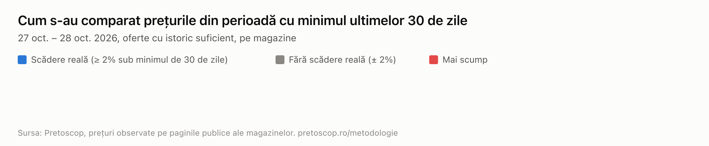
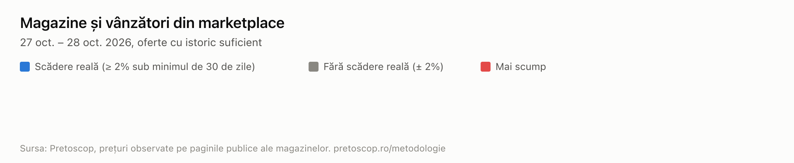
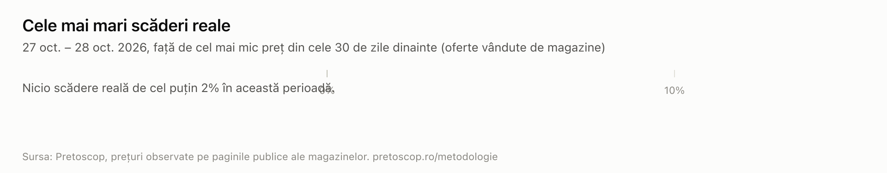

# Verificare M23 (date Phase 0)

Perioada analizată: 27 oct. – 28 oct. 2026 (zile în ora României). Date generate la 2026-10-27T22:53:18.974Z.

> **Date preliminare.** Cifrele nu se publică până nu sunt verificate și aprobate de fondatori (`report:approve`).

## Pe scurt

- 821 oferte au fost în stoc în perioadă, la 1 magazin; 0 au istoric suficient (observate în cel puțin 70% din cele 30 de zile dinainte).
- Nicio ofertă cu istoric suficient nu a afișat o reducere în perioadă.
- Scădere reală (cel puțin 2% sub minimul celor 30 de zile): 0 oferte; fără scădere reală: 0; mai scump: 0. Variația mediană: —.
- Regula „preț crescut înainte, apoi redus” nu a putut fi evaluată: cere 60 de zile de istoric înaintea perioadei.

## Grafice

## Pe magazine

Nicio ofertă cu istoric suficient.

## Vândut de magazin sau prin marketplace

Nicio ofertă cu istoric suficient.

## Pe categorii

Nicio ofertă cu istoric suficient.

## Cele mai mari scăderi reale

Nicio scădere reală de cel puțin 2% (pe ofertele vândute de magazine, cu istoric suficient).

## Prețuri crescute înainte, apoi reduse

Nu a putut fi evaluată (60 de zile de istoric necesare).

## Metodologie

- Sursa: prețurile observate de Pretoscop pe paginile publice ale magazinelor (robotul PretoscopBot, https://pretoscop.ro/bot) și din fluxurile de produse ale magazinelor. Doar oferte noi, nu pachete, în stoc.
- „Scădere reală”: cel mai mic preț din perioadă este cu cel puțin 2% sub cel mai mic preț observat la aceeași ofertă în cele 30 de zile dinainte. Comparația se face doar dacă am observat oferta în cel puțin 70% din acele zile.
- „Reducere afișată”: magazinul a afișat un preț de referință tăiat, mai mare decât prețul de vânzare. Nu verificăm ce spune magazinul despre acel preț; îl comparăm doar cu prețurile pe care le-am observat noi.
- „Preț crescut înainte, apoi redus”: vârful din [−30, −3] zile este cu cel puțin 15% peste mediana din [−60, −31] zile, iar prețul din perioadă este încă la cel puțin 97% din acea mediană.
- Prețul unei zile este cel în vigoare la sfârșitul zilei, după ultima noastră observație. Zilele fără observații rămân goale; nu interpolăm.
- Scăderile pe produse folosesc doar ofertele vândute direct de magazine (ca seria principală din graficele de istoric).
- Detalii: https://pretoscop.ro/metodologie

## Note

- 821 din 821 oferte nu au istoric suficient (observate în mai puțin de 70% din cele 30 de zile dinaintea evenimentului) și nu intră în procente.
- Regula „preț crescut înainte, apoi redus” cere 60 de zile de istoric înaintea evenimentului; nu a putut fi evaluată pentru nicio ofertă.
- Numele vânzătorilor din marketplace nu sunt publicate; apar doar agregat.

## Date

`oferte.csv` (o linie pe ofertă), `magazine.csv`, `scaderi.csv`, `crescut-redus.csv`, `report.json` (schema `pretoscop.report/v1`). Prețuri în lei, cu TVA.
